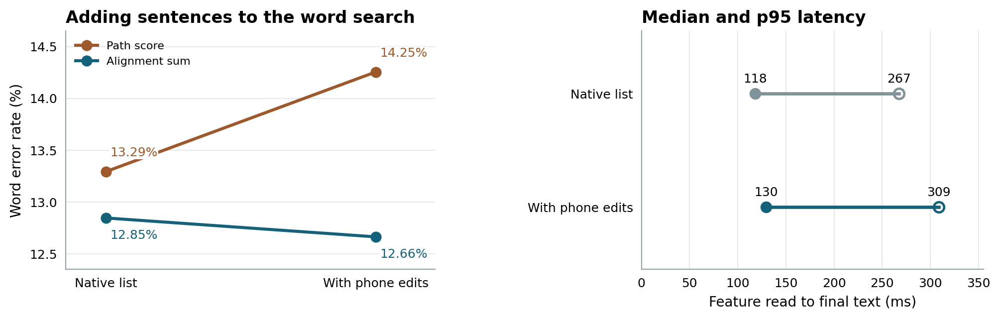

# BTT-25-CW

BTT-25-CW decodes attempted speech from the released T15 intracortical recordings. It runs the authors’ pretrained GRU on 20 ms feature bins, saves the phoneme logits, and uses those logits to compare word decoders without rerunning the encoder. The recordings come from one participant. [Dataset and terms](docs/DATA_CARD.md)

## How well it works

On the 926 tuning sentences, the best word decoder made **764 errors in 6,033 words (12.66% WER)**. It keeps plausible one-phone edits in the word list and scores each candidate over the different ways its phones could align with the GRU frames. The earlier DistilGPT2 rule made 802 errors on those same words. A complete request took **130 ms at the median and 309 ms at p95** on one A100 80 GB PCIe with four CPU cores, measured from a released feature trial through final text. This is an offline tuning result. [Decoder study](reports/phone_robustness.md) · [Candidate and timing counts](reports/expanded_phone_words.json)



We also trained a model that updates its recurrent state every 80 ms and emits a phone distribution halfway between updates. Merging adjacent frames that picked the same class cut compact-decoder WER from **28.49% to 19.76%**. With the expanded word list and DistilGPT2, the same change saved 238 word errors and brought the model to **15.15% WER**. Every tuning trial retained its original greedy phoneme sequence. The expanded two-rate decoder took 337 ms at p95 on one A100-40GB with either input. [Training and inference costs](reports/rate_v4.md) · [Compact search comparison](reports/rate_decode_v4.md) · [Expanded search comparison](reports/two_rate_expanded.md)

### Earlier validation results

| System | Word errors on `dev_report` | WER | Feature-to-text p95 |
| --- | ---: | ---: | ---: |
| Original compact decoder | 678 / 3,412 | 19.87% | 104 ms |
| Repaired beam-250 search | 571 / 3,412 | 16.74% | 250 ms |
| Repaired search + DistilGPT2 | 505 / 3,412 | **14.80%** | 285 ms |


In the v2 comparison, DistilGPT2 had the lowest WER on tuning and on full validation, where it reached **13.84% WER** (1,307 errors in 9,445 words). Qwen3-4B made two fewer errors on `dev_report`. Treat both v2 scores as exploratory. We had already seen the v1 report when we planned these runs. Latency comes from three interleaved passes over the same 96 requests per system on one A100. [V2 report and measurements](reports/continuation.md) · [Previous public summary](https://github.com/Clement-Wright/BTT-25-CW/blob/77d4971c06afd2d4eda8b15e7daddef1562648d1/README.md)

The largest gain came from search. Flashlight’s six-label terminal limit made 208 dictionary words unreachable. After removing it and widening the beam, the best available candidate per trial would score **9.38% WER** on tuning. The decoder still often ranks a worse candidate first. [Candidate coverage](reports/continuation.md#candidate-coverage)

The expanded decoder produced 1,450 nonempty hidden-test predictions in official order. The release withholds the labels, so the CSV establishes coverage only. [Current inference and export command](reports/phone_robustness.md) · [Earlier v2 export](docs/CONTINUATION.md)

## Run it

Get the authorized T15 release and verify its hashes. Use [the setup guide](docs/REPRODUCE.md) to prepare `configs/local.yaml`, then run:

```bash
python -m btt25.cli infer --config configs/local.yaml --split val --run-dir runs/baseline-val
python -m btt25.cli evaluate --config configs/local.yaml \
  --predictions runs/baseline-val/predictions.jsonl \
  --output-dir runs/baseline-phones-tune --phoneme-only
```

The second command scores phonemes on `dev_tune` by default. For word decoding, checkpoints, or reproduction on an A100, follow the [Gilbreth instructions](docs/GILBRETH.md) and [v2 commands](docs/CONTINUATION.md). Keep data, weights, and reference-bearing outputs outside Git.

To run the 12.66% tuning system from neural features, use the reference-free `btt25.phone_word_inference` command in the [word-decoder report](reports/phone_robustness.md). For a CPU-only laptop, the repaired three-gram decoder with a quantized GRU reached **17.64% tuning WER** and **222 ms p95** on four i9-11980HK threads. The laptop path also replays incoming 20 ms bins and displays provisional words. [CPU measurements and replay](reports/consumer_v4.md) · [Laptop commands](docs/REPRODUCE_LAPTOP_V4.md)

## Reports and reference

- How much the word search recovers from imperfect phone evidence. Supplying the reference phones reduced compact WER from 15.80% to 2.34% on tuning. Summing over CTC alignments for real GRU outputs reduced DistilGPT2’s word edits from 802 to 775 on the same 6,033 words. [Phone and word errors](reports/phone_robustness.md)
- What changed when the same neural trial was smoothed, rebinned or decoded at a different rate, including the perfect-phone diagnostic. [Temporal study](reports/temporal.md)
- Training at 20, 40 and 80 ms, including an intermediate phone head between recurrent updates. [Rate study](reports/rate_v4.md) · [Reproduction commands](docs/REPRODUCE_RATE_STUDY.md)
- Beam search, Qwen, LightBeam, the Transformer, and the diphone comparison. [V2 report](reports/continuation.md)
- Confidence gating and session calibration. [V1 report](reports/results.md) · [Archived v1 revision](https://github.com/Clement-Wright/BTT-25-CW/tree/fe5fb4081f2ce256b41ba2a91f104a6a64a53deb)
- Weights, preprocessing, and licenses. [Model card](docs/MODEL_CARD.md) · [Provenance](docs/PROVENANCE.md) · [Third-party terms](THIRD_PARTY_NOTICES.md)
- Why we chose these comparisons and where work stopped. [Research context](docs/RESEARCH_CONTEXT.md) · [Recovery audit](docs/RECOVERY_AUDIT.md) · [Project state](docs/STATE.md)
