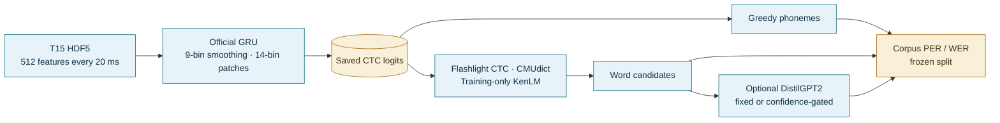
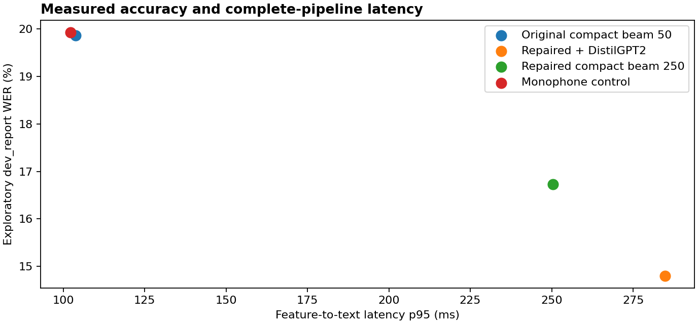
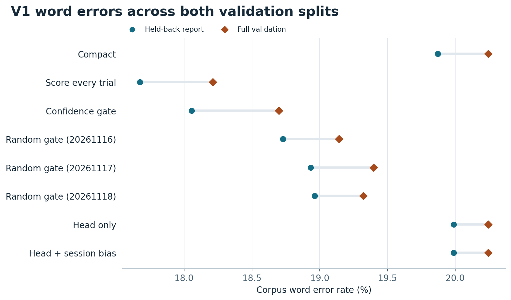

# BTT-25-CW

An offline brain-to-text pipeline for the [T15 Brain-to-Text ’25 release](https://datadryad.org/dataset/doi:10.5061/dryad.dncjsxm85). It recovers the organizers’ pretrained GRU, saves phoneme and word predictions by trial, and measures which decoding and calibration changes are worth their compute.



## Measured results

The v2 system selected on `dev_tune` combines the official GRU, repaired beam-250 Flashlight search, and DistilGPT2 reranking. It scored **14.80% WER on `dev_report`** and **13.84% on full validation**, with **285 ms p95** from released features to final text on one A100. These scores are exploratory because v1 reporting results informed v2. The repaired candidate list reached a 9.38% tuning oracle at up to 50 candidates. [V2 results, timing, and LightBeam comparison](reports/continuation.md)



The v2 hidden-test export contains 1,450 predictions in official order. Test labels remain unavailable. The [continuation runbook](docs/CONTINUATION.md) explains how to reproduce the export and the comparison runs.

### Archived v1 results

Both the laptop and A100 runs saved phonemes for all 1,426 validation trials. Their decoded phone sequences and frame counts agreed on every trial. The laptop took 132.5 seconds for inference. Its separate CPU lexicon-only fallback took 67.5 seconds and scored 75.78% WER on `dev_tune`. The train-only KenLM decoder selected on the A100 run scored 20.45% WER on that same split. [Development evidence](reports/development.json)

The 15-minute laptop calibration pilot peaked at 2.39 GB process-tree RSS and 3.13 GB total GPU memory in use. Available system RAM stayed above 4.40 GB. [Laptop measurements](reports/laptop_baseline.json) · [Gilbreth setup and pilots](reports/gilbreth_setup.json)

The frozen `dev_report` subset covers 500 trials and 3,412 reference words. The compact baseline scored 10.54% PER.

| Condition | Word edits | WER |
| --- | ---: | ---: |
| Unchanged GRU + compact KenLM | 678 | 19.87% |
| DistilGPT2 on every trial | 603 | 17.67% |
| Confidence-gated DistilGPT2 | 616 | 18.05% |
| Matched random gates (three seeds) | 639–647 | 18.73–18.96% |
| Head-only calibration | 682 | 19.99% |
| Head + session-bias calibration | 682 | 19.99% |

The confidence gate used 687 of 1,426 full-validation additional LM calls. Its 0.38-point WER cost relative to scoring every trial exceeded the 0.2-point target (95% session interval +0.15 to +0.65 points). It beat all three matched random gates on the held-back split. On the 39 random-word trials in full validation, WER rose from 40.50% to 43.00% with gating and to 44.50% with every-trial rescoring. Those trials were in the tuning slice.

Head-only and session-bias calibration tied on held-back word and phoneme edits. Both used 720 updates on the same official-training trials. Their WER difference from the unchanged checkpoint was +0.12 points (95% session interval −0.07 to +0.30 points).



[Full results, paired intervals, subgroup findings and resource plots](reports/results.md) · [Machine-readable evidence](reports/results.json)

The official-order test export contains 1,450 rows. Test references are hidden, so the release reports coverage only.

The project uses the checkpoint’s fixed day map, phone order, and valid Gaussian smoothing. Audio or raw neural signal preprocessing is outside the scope of these released features. Validation was used to select the original checkpoint. The local report split measures the two new comparisons on held-back trial groups within that benchmark.

## Reproduce

Obtain the expanded dataset from Dryad and use the checksum-pinned assets. Follow [setup and complete commands](docs/REPRODUCE.md) for inference, word decoding, evaluation, calibration, and test export. The [Gilbreth runbook](docs/GILBRETH.md) covers the scratch layout and bounded Slurm jobs used on A100 GPUs.

```bash
python -m btt25.cli infer --config configs/local.yaml --split val --run-dir runs/baseline-val
python -m btt25.cli evaluate --config configs/local.yaml \
  --predictions runs/baseline-val/predictions.jsonl \
  --output-dir runs/baseline-phones-tune --phoneme-only
```

Each scoring command defaults to `dev_tune`. A joint freeze binds both study configurations, weights, and artifact hashes before `dev_report` or `official_val` can be scored. Failed and empty hypotheses stay in the edit counts. Full logs, weights, neural recordings, and external assets live outside Git.

- [Dataset card](docs/DATA_CARD.md) and [model card](docs/MODEL_CARD.md)
- [Source provenance and licenses](docs/PROVENANCE.md) and [recovery audit](docs/RECOVERY_AUDIT.md)
- [Research context](docs/RESEARCH_CONTEXT.md) and [project state](docs/STATE.md)

This is research on one participant using released, preprocessed trials. See the dataset terms and [third-party notices](THIRD_PARTY_NOTICES.md) before reusing external assets.
