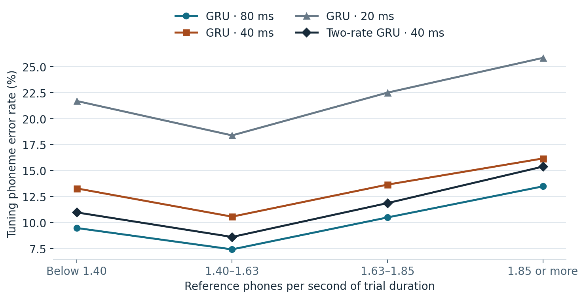

# Why did the output clock change the phone errors?

Training the GRU to update every 20 ms produced 826,273 output frames on the 926 tuning trials. The matched 80 ms GRU produced 206,896. Both saw the same 2,048 training presentations. The 20 ms model had nearly 31 frames per target phone, yet it deleted 2,164 phones. The 80 ms model had 7.75 frames per target phone and deleted 595. Running out of CTC positions cannot explain this gap.

The blank class ranked first on 92.84% of the 20 ms frames and 74.92% of the 80 ms frames. Faster recurrence also made more substitutions and insertions. The 20 ms model made 5,950 phone edits and 2,154 word edits. The 80 ms model made 2,772 and 1,081. The paired WER difference was 17.79 percentage points, with a 95% session/block bootstrap interval of 15.40 to 20.03 points. This compares equal adaptation budgets on one exposed tuning split. The upstream checkpoint learned its recurrent gates at 80 ms.

At the highest target-density quartile, PER was 25.83% at 20 ms and 13.48% at 80 ms. Density counts the reference phones, including SIL, over the duration of the whole recorded trial. There are no individual phone onset times. None of the 26,680 reference IDs immediately repeats its predecessor, so this split cannot estimate how the different clocks handle adjacent identical target phones.

## Which errors changed?

| Trained encoder | Blank ranked first | Frames / target phone | Phone substitutions | Deletions | Insertions | PER | WER |
|---|---:|---:|---:|---:|---:|---:|---:|
| GRU, 80 ms | 74.92% | 7.75 | 1,923 | 595 | 254 | 10.39% | 17.92% |
| GRU, 40 ms | 84.54% | 15.49 | 2,388 | 761 | 468 | 13.56% | 24.96% |
| GRU, 20 ms | 92.84% | 30.97 | 3,153 | 2,164 | 633 | 22.30% | 35.70% |
| 80 ms GRU plus a learned midpoint | 75.66% | 15.49 | 2,037 | 521 | 617 | 11.90% | 28.53% |

The midpoint preserved more of the greedy phone sequence than the 40 ms recurrent model. Under the same word search it made more word errors. Its most common phone error was substitution, but its insertions also exceeded the slower GRU's by 363. Keeping a frequent phone estimate calls for a word search that accounts for how much adjacent estimates share. The companion decoder experiment tests that hypothesis directly. CTC training can favor alignments with brief nonblank peaks; our blank counts measure the trained output and do not identify a unique cause. [Rate-aware decoder](rate_decode_v4.md) · [Zeyer et al. on CTC alignment](https://arxiv.org/abs/2105.14849)

## What did the learned filter change?

The transient-sensitive filter changed little after 2,048 updates. The official Gaussian's half-height width is 95.12 ms. On a flat input window, the learned filter had median width 95.47 ms across 512 channels. At an absolute difference of three standardized units between the window's endpoints, the median was 95.64 ms and the middle 80% of channels spanned 93.24–98.05 ms. These are evaluations of the fitted filter at fixed input differences. Each width uses linearly interpolated half-height crossings around the largest tap.

The filter saved two word edits out of 6,033 versus the matched 40 ms GRU, from 1,506 to 1,504. The difference was −0.03 percentage points, with a paired-session interval of −0.79 to +0.73. The channelwise filter stayed near its Gaussian initialization at this training budget.

| Change at 40 ms | Word edits | WER | Change vs unmodified 40 ms GRU | 95% paired-session interval, pp |
|---|---:|---:|---:|---:|
| Learn the nine-tap filter | 1,504 | 24.93% | −0.03 pp | −0.79 to +0.73 |
| Adjust softsign | 1,477 | 24.48% | −0.48 pp | −1.03 to +0.05 |
| Add a rank-16 input transform | 1,447 | 23.98% | −0.98 pp | −2.07 to −0.07 |
| Learn both transform and activation | 1,332 | 22.08% | −2.88 pp | −3.75 to −2.05 |
| Widen the patch from 14 to 20 bins | 1,352 | 22.41% | −2.55 pp | −3.39 to −1.80 |

In the combined model, the added transform had a Frobenius norm 5.55% of the identity matrix's norm. Its largest singular value was 1.14, so a change concentrated in a few directions could still be substantial. For the activation, the median coefficient multiplying tanh minus softsign was 0.0042. It was negative in 168 of 512 channels. These measurements describe fitted parameters. The controlled word-error rows give the evidence about recognition. The intervals in this table resample the same 33 sessions together across conditions using 2,000 draws. They are exploratory intervals for individual comparisons.

The full aggregate includes all 13 conditions, each trial-duration and target-density quartile, errors by phone, common substitutions and the learned filter taps averaged over channels. Gilbreth jobs 12625922 and 12626246 examined the archived logits and agreed on the shared 80 ms control. Job 12625521 stopped during scratch setup before analysis. The tiny convolutional student deleted 10,022 of 26,680 target phones at this training endpoint. A substantial latency or parameter saving alone would not meet the word-accuracy requirement. [Cadence and filter measurements](cadence_v4.json) · [Phone, session and corpus error counts](cadence_phone_errors_v4.json) · [Training design](../docs/RATE_STUDY_V4.md)
