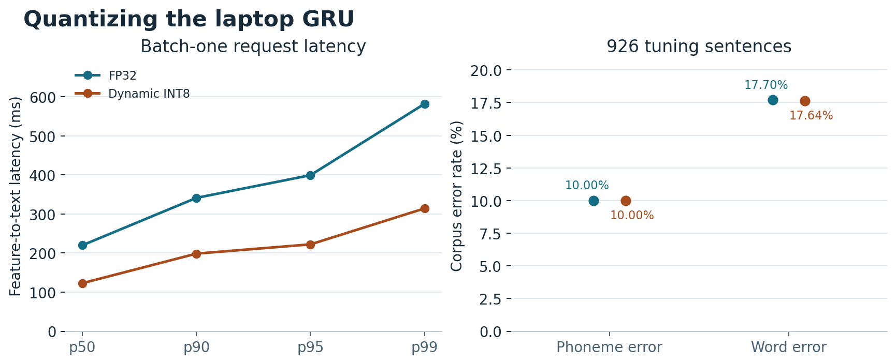
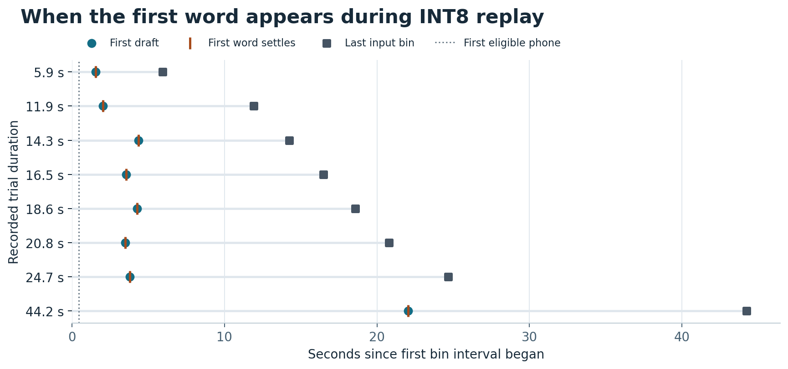

# Phone and word updates on a laptop CPU

We replayed T15 recordings on an eight-core Intel Core i9-11980HK laptop with 32 GiB of installed RAM. The encoder used four Torch threads. A persistent Flashlight process handled word search. Both ran on the CPU. The INT8 version packs the GRU and phone classifier. Its 45 session transforms stay in FP32. The inputs were the 512 released features in each 20 ms bin.

## Repaired search under WSL

The INT8 GRU with the training-only three-gram made **1,064 word errors in 6,033 words (17.64% WER)**. Its FP32 control made four more errors. Both decoded all 926 tuning trials. The speed difference was larger. INT8 returned final text in 222 ms at p95, compared with 399 ms for FP32. The inherited checkpoint was selected on official validation. These are development scores for known sessions. Each batch-one timing starts at the HDF5 read. Three warm passes alternated the two models on the same 96 utterances, selected across the recorded duration range.

| WSL, repaired Flashlight beam 50 and train-only KenLM | FP32 | Dynamic INT8 |
| --- | ---: | ---: |
| Phone errors / 26,680 | 2,669 (10.004%) | 2,668 (10.000%) |
| Word errors / 6,033 | 1,068 (17.70%) | 1,064 (17.64%) |
| p50 / p90 / p95 / p99 / max (ms) | 220 / 341 / 399 / 582 / 937 | 123 / 198 / 222 / 314 / 346 |
| Wall time divided by recorded duration | 0.01316 | 0.00729 |
| Peak sampled Linux process-tree RSS (GB) | 1.205 | 1.124 |
| Peak sampled Windows working set of entire WSL VM during scoring (GB) | 1.847 | 1.674 |
| Load and verify encoder, including conversion (s) | 2.72 | 3.15 |
| Load native decoder (s) | 2.21 | 2.12 |

INT8 made fewer word errors on 14 sentences and more on 13. The remaining 899 had the same edit count. The paired difference was −0.066 percentage points, with a 95% interval of −0.320 to +0.157 from resampling the 33 tuning sessions. Each accumulated 81 edits on the 200 reference words in the random-text subset. The evidence favors INT8 for CPU latency. The small difference in WER is unresolved.

Cold loading and warm request timings were measured separately. The real-time factor uses each original recording's duration, including quiet bins. The longest third of the timing trials had a p95 of 280 ms for INT8 and 474 ms for FP32. The Linux memory samples cover the encoder and decoder processes. The separate Windows samples cover WSL's kernel, resident caches and other WSL activity. These observers cover overlapping memory. Estimating a minimum laptop configuration would require measurements on smaller machines.

The repaired trie passed a seven-homophone check. Its native libraries and the 525 KiB three-gram transferred in five seconds, 5.28 MB in total. Installing the one missing h5py wheel took another 1.9 seconds. The official checkpoint, released features and CPU-capable Torch runtime were already present. The CPU loader starts from the verified FP32 source before quantizing. [Reproduction commands](../docs/REPRODUCE_LAPTOP_V4.md)

## What appeared before the recording ended

We played eight recordings back at 50 Hz, reading one new row from HDF5 at each deadline. The recordings lasted 5.94 to 44.24 seconds and totaled 156.88 seconds. The encoder kept its filter history, overlapping patch and recurrent state. Flashlight advanced its search on each new phone posterior. Previous words remained visible and could change. The supplied trial boundary committed the final sentence.

The official model needs 22 acquired bins before the first posterior is available at 440 ms. After that it returns a 41-class vector every 80 ms. The first posterior reached the draft decoder at a median of 451 ms in FP32 and 448 ms in INT8. The INT8 decoder processed 1,920 posterior updates but changed the visible draft only 60 times, 0.38 changes per second across those recordings. Its first draft word appeared at a median of 3.68 s from trial start. Its first permanently stable word had the same median. Individual first drafts ranged up to 22.04 s. The dataset provides no intended word-onset timestamps.

The median finalization delay after the last observed bin was 1.71 ms for FP32 and 1.69 ms for INT8. Each replay returned the same final words as its own batch decoder on all eight trials. Both made six edits against the subset's 51 reference words. The 926-trial table above is the accuracy comparison. Three offline prefix checks per trial also exposed a quantization detail. Appending future bins to a vectorized INT8 forward pass changed earlier logits by up to 0.713, while FP32's largest difference was 0.000008. No frame argmax changed in those 24 checks. The replay's incremental encoder receives only bins that have arrived.

We also audited an earlier confirmation rule. A word could be confirmed after five agreeing drafts if one later word also remained stable. Both models would have confirmed 44 words across eight trials. All those prefixes matched their own eventual final text, including any recognition errors in it. INT8's median first confirmation came 5.92 s after trial start. Eight utterances give an initial estimate of how much delay the rule adds.

## The trained 40 ms head on the same laptop

The two-rate model advances the GRU every 80 ms and emits a learned midpoint between consecutive anchors. Its midpoint head sees the preceding GRU state and the change across the latest four transformed feature bins. We transferred the completed 2,048-update model's 7,245,586 trainable parameters as a verified 28.99 MB delta and replayed exactly the same eight recordings through the WSL three-gram decoder.

| Eight-trial sensor-clock replay | Official FP32 | Official INT8 | Trained two-rate FP32 |
| --- | ---: | ---: | ---: |
| Posterior interval after startup | 80 ms | 80 ms | 40 ms |
| Posteriors sent to word search | 1,920 | 1,920 | 3,840 |
| First posterior, median | 451 ms | 448 ms | 452 ms |
| First draft word, median | 3.687 s | 3.683 s | 3.704 s |
| First stable word, median | 3.687 s | 3.683 s | 3.984 s |
| Finalization after last observed bin, median | 1.71 ms | 1.69 ms | 2.20 ms |
| Changes to the visible draft | 63 | 60 | 99 |
| Peak process-tree RSS during replay | 0.983 GB | 0.999 GB | 0.971 GB |
| Word errors / 51 | 6 | 6 | 13 |
| Phone errors / 221 | 16 | 17 | 23 |

All 3,840 streaming frame argmaxes matched the two-rate batch encoder. The largest logit difference was 0.0000344. The two-rate final transcript matched its fully batched pipeline on seven recordings. Repeating word search on identical emissions also exposed ties. Incremental and batch search returned equal total scores on all eight, with different final text on two. The five-draft confirmation rule would have committed an eventual disagreement on two recordings for the two-rate model. Five consecutive drafts span 160 ms at the faster rate and 320 ms at the original rate. A 40 ms posterior clock worked on this laptop. It produced more revisions and gave little change in first-draft time. The [full rate study](rate_v4.md) compares accuracy across all 926 tuning utterances.

## Native Windows

The Windows wheel ran a beam of 50 with a pronunciation lexicon and ZeroLM. It gave the same score to competing word sequences with identical pronunciations. In three warm passes over 96 inputs, the FP32 route returned more than one spelling on 90 inputs. Even two successive batch searches on identical saved emissions agreed on only three of eight replay trials. That variability limits how precisely this route can measure the effect of quantization on word choice.

| Native Windows, ZeroLM | FP32 | Dynamic INT8 |
| --- | ---: | ---: |
| Phone errors / 26,680 | 2,669 | 2,668 |
| Word errors / 6,033 | 4,559 | 4,538 |
| Word error rate | 75.57% | 75.22% |
| Feature-to-text p95 | 337 ms | 178 ms |
| Aggregate real-time factor | 0.01094 | 0.00590 |
| Peak process-tree RSS during scoring | 1.345 GB | 1.373 GB |

Both routes returned final predictions for all 926 tuning trials. The paired 95% session-bootstrap interval for INT8 minus FP32 WER was −1.54 to +0.84 percentage points. The serialized model shrank from 177.29 MB to 79.87 MB. Windows still needed slightly more resident memory in the INT8 run. The measurement includes loading the FP32 checkpoint, packing the smaller weights, Torch, the lexicon and the native decoder.

## What reaches the decoder

The release contains two intracortical measurements per implanted electrode from one participant. It also supplies the recording boundary and session index. We replay those already-normalized features from disk. A live system would have to reproduce their acquisition and normalization and determine when an attempt ends. [T15 data card](../docs/DATA_CARD.md)

Scalp EEG measures voltages from a different sensor layout. The T15 session transforms expect particular cortical channels. The replay rejects a scalp-EEG modality identifier. A public 64-channel scalp-EEG dataset includes listening and repeating 20 words and 20 pseudowords alongside a phoneme task. It supports a separately trained closed-vocabulary test. An October 2026 preprint found that none of 482 cross-person imagined-speech comparisons survived correction across three scalp-EEG datasets. A companion audit found that lip electrodes alone carried much of the overt-speech signal on one corpus. [Moreira et al.](https://www.nature.com/articles/s41597-025-05187-2) · [Cross-person evaluation](https://arxiv.org/abs/2610.20954) · [Artifact controls](https://arxiv.org/abs/2610.20942)

Consumer-headset sentence WER remains unmeasured. That experiment needs synchronized scalp recordings and intended-text labels, held-out recording sessions, and controls for cues, eye movement and facial muscle activity. The laptop results below the memory cap apply to the released intracortical input.

The private run directories contain per-trial emissions-derived phone sequences, word predictions, draft histories, timers and resources. The public aggregate includes per-session and per-corpus edits, percentile timings by duration, source and weight hashes, and the paired uncertainty calculation. [Aggregate evidence](consumer_v4.json) · [Commands and setup](../docs/REPRODUCE_LAPTOP_V4.md)
