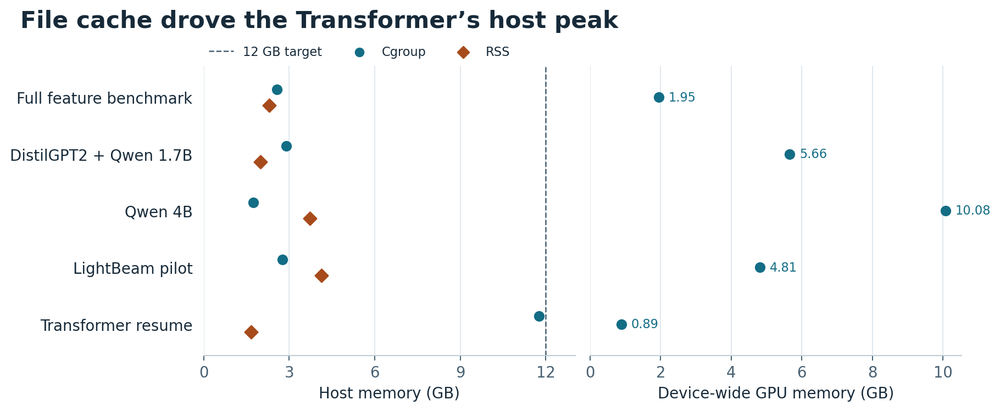

# Accuracy and efficiency continuation

The tuning-selected v2 system combined repaired beam-250 Flashlight with pinned DistilGPT2 reranking of up to 25 saved candidates. It made **505 / 3,412 word edits (14.80% WER)** on the 500-trial `dev_report` benchmark and **1,307 / 9,445 (13.84%)** on all 1,426 validation trials.

These results are exploratory. The frozen v1 analysis, available at its [release revision](https://github.com/Clement-Wright/BTT-25-CW/blob/fe5fb4081f2ce256b41ba2a91f104a6a64a53deb/reports/results.md), informed this continuation. V1's every-trial DistilGPT2 condition scored 17.67% WER on the 500-trial `dev_report` selection and 18.21% on full validation. V2 development uses the same 926-trial `dev_tune` partition, and the existing reporting benchmark cannot serve as a fresh holdout for v2.

## Frozen v2 results

The selection and artifact hashes were sealed before v2 opened reporting references. Freeze: `db4bae4fbcd3783cbdd55b50bfb5569002db7eeef5ded7c51db54cc867fef9b8`.

| Condition | `dev_tune` WER | Exploratory `dev_report` WER | Exploratory full-validation WER |
| --- | ---: | ---: | ---: |
| Original compact beam 50 | 20.45% | 19.87% | 20.24% |
| Repaired compact beam 250 | 15.80% | 16.74% | 16.14% |
| Repaired + DistilGPT2, tuning-selected | 13.29% | 14.80% | 13.84% |
| Repaired + Qwen3-1.7B-Base | 13.49% | 15.01% | 14.04% |
| Repaired + Qwen3-4B-Base | 13.41% | 14.74% | 13.89% |
| Monophone control, original compact beam 50 | 20.60% | 19.93% | 20.36% |
| Joint diphone adaptation, original compact beam 50 | 23.39% | 22.63% | 23.11% |

The selected system made 173 fewer report edits than original compact: a change of −5.07 percentage points, with a paired session-block bootstrap interval of −6.26 to −3.94 points. It improved 153 trials and worsened 30. All frozen conditions covered all 1,426 validation trials with zero failed predictions; the official GRU’s report PER remained at 10.54% across decoder conditions. Reaching 10% requires 164 more edits removed on `dev_report`, or 363 on full validation. The [sealed evidence](continuation.json) includes edit types, paired intervals, session/corpus totals, and fixed examples. Reference-bearing examples remain with the private run.

### Fixed-candidate scoring

Qwen 4B had the lowest observed exploratory `dev_report` WER, two edits below DistilGPT2. DistilGPT2 led on tuning and full validation. All three neural models scored the same candidates using Flashlight’s acoustic component and a teacher-forced language prior, and each chose weight 1.25 on tuning, the largest registered value.

Qwen 4B versus Qwen 1.7B changed `dev_report` WER by −0.26 points, with a paired session-block interval of −0.76 to +0.20 points. It saved nine Switchboard edits and added two on OpenWebText. Random-word behavior must be assessed on tuning because the reporting split contains no random-word corpus. On those 200 tuning tokens, repaired compact made 76 errors, versus 82 with DistilGPT2, 78 with Qwen 1.7B, and 81 with Qwen 4B.

Incremental scoring was fastest with DistilGPT2: across full validation, cached-candidate p95 was 34 ms, compared with 150 ms for Qwen 1.7B and 188 ms for Qwen 4B. DistilGPT2 and Qwen 1.7B shared one Slurm allocation. Qwen 4B scored the identical candidate file in a separate allocation with the same requested resources. Device-wide peaks for the two jobs were 5.66 and 10.08 GB, respectively. Given the observed accuracy differences, these lists offer little reason to move to an 8B reranker.

### Matched end-to-end timing after the freeze

All 1,152 feature-to-text requests completed without failures or timeouts on one PCIe A100 40 GB allocation with four CPUs. Each system decoded the same 96 trials over three interleaved warm passes. The real-time factor uses the original input duration.

| System | p50 | p90 | p95 | p99 | Max | Real-time factor |
| --- | ---: | ---: | ---: | ---: | ---: | ---: |
| Original compact beam 50 | 59.3 ms | 91.6 ms | 103.9 ms | 128.7 ms | 157.1 ms | 0.00352 |
| Repaired compact beam 250 | 110.6 ms | 228.7 ms | 250.4 ms | 285.5 ms | 333.6 ms | 0.00707 |
| Repaired + DistilGPT2 | 140.6 ms | 260.3 ms | 284.7 ms | 355.2 ms | 783.6 ms | 0.00863 |
| Monophone control | 58.7 ms | 91.3 ms | 102.3 ms | 125.7 ms | 166.2 ms | 0.00349 |

WER uses the 500-trial `dev_report` benchmark. Timing uses three warm passes over the same 96 trials per system.

The tuning-selected system completed 6.33 requests per second of request time. Cold DistilGPT2 setup took 61.71 s, and the native decoder became ready in 2.79 s. The shared harness peaked at 2.57 GB cgroup memory, 2.29 GB process-tree RSS, 2.21 GB process-tree PSS, and 1.95 GB device-wide GPU memory. These peaks cover all resident workers. The benchmark does not measure streaming latency. [Timing distributions and accounting](continuation.json)

### Alternative encoder objectives

The joint diphone head worsened report WER by 2.70 points versus the monophone control, with a paired session-block interval of +1.90 to +3.40 points. It improved 49 trials and worsened 121; report PER rose from 10.66% to 11.72%. The two frozen-GRU arms each received 1,024 updates and kept the original compact decoder. This comparison tests a T15 objective adaptation. The published DCoND-LIFT system used T12 with additional stages.

The completed 9.73-million-parameter scratch-trained Transformer scored 59.97% on `dev_tune` with the same beam-50 three-gram decoder as the official GRU. Its oracle at up to 50 was 49.64%, compared with 15.61% for the original GRU. Low candidate coverage places most of the gap before final reranking. This compares a bounded scratch-trained Transformer with a mature pretrained GRU.

The Transformer passed its 901-second pilot with 21,466 updates, then stopped at update 24,987 with a valid checkpoint when cgroup charge reached 12.014 GB. Process-tree RSS peaked at 1.54 GB. A fresh allocation resumed to the registered 40,000-update endpoint and decoded all 1,426 validation trials. Before training resumed, scoped cache advice for the 45 private training HDF5 files reduced live cgroup charge from 11.64 GB to 3.57 GB in 2.98 s; anonymous memory stayed near 1.41 GB. The resumed training phase peaked at 11.76 GB cgroup charge, 1.67 GB process-tree RSS, and 0.89 GB device-wide GPU use. The first v2 freeze excludes the stopped attempt.

In the addendum, the Transformer made **1,914 / 3,412 report edits (56.10%)**, with 29.15% PER, and **5,532 / 9,445 full-validation edits (58.57%)**. It added 36.23 WER points over the unchanged GRU with the same decoder; the 95% paired session-block interval was +31.01 to +41.38 points. Both covered all trials. On the second set of three interleaved warm passes with the same decoder, Transformer p95 was 109.8 ms versus 109.3 ms for the official GRU. The smaller encoder gave similar whole-pipeline latency at substantially worse accuracy.

The addendum sealed `38b64da860fce6a1369136adbf6c2b9e5878bdaab83952e4b171baa4b6cf2e0a`. Although the Transformer endpoint and decoder were registered before the first v2 reporting pass, the resume and addendum ran after that report was available. This comparison is also exploratory. [Addendum and its matched timing](continuation.json)

## Candidate coverage

Widening the original search from beam 50 to 250 removed 217 oracle errors on tuning. This comparison held the official GRU emissions, decoder thresholds, lexicon, and training-only KenLM weights fixed. Each new arm saved all 1,426 validation hypotheses before scoring the tuning slice. Oracle cutoffs use the actual distinct candidates returned. A failed or empty hypothesis would contribute its full word deletions to the corpus count.

| Decoder | Selected edits | Selected WER | Oracle@10 | Oracle@25 | Oracle@50 |
| --- | ---: | ---: | ---: | ---: | ---: |
| Archived beam 50, 10 requested | 1,234 | 20.45% | 16.34% | 16.34% | 16.34% |
| Original beam 50, 50 requested | 1,234 | 20.45% | 16.34% | 15.65% | 15.61% |
| Original beam 100, 50 requested | 1,163 | 19.28% | 15.12% | 14.16% | 13.77% |
| Original beam 250, 50 requested | 1,101 | 18.25% | 14.01% | 12.78% | 12.02% |
| Repaired beam 50, 50 requested | 1,068 | 17.70% | 13.36% | 12.68% | 12.66% |
| Repaired beam 100, 50 requested | 1,011 | 16.76% | 12.28% | 11.27% | 10.92% |
| Repaired beam 250, 50 requested | 953 | 15.80% | 11.22% | 10.00% | 9.38% |

Each row uses 6,033 reference words. Repairing the trie at beam 250 removed another 148 selected errors and 159 oracle errors. The repaired top-50 oracle makes 566 edits, leaving 37 edits of room below the 10% threshold. Its 387-edit gap to the selected output applies to this tuning set and saved list. The archived list has at most ten candidates, so its higher oracle cutoffs all reuse that list.

The native trie audit traced the lost vocabulary to a six-label terminal cap: it dropped 224 pronunciation entries and made 208 word types unreachable. Nine of those types appeared 1,414 times in training, including 1,324 instances of `you`. The repair retained all 134,711 pronunciations and reduced tuning lexicon OOVs from 144 to 3 word tokens. KenLM OOVs stayed at 402 tokens because the three-gram was unchanged. [Registration and commands](../docs/CONTINUATION.md)

Most of the beam-250 repair gain came from Switchboard: 130 fewer errors over 4,569 words. Random-word trials tied at 76 errors over 200 words, while Harvard sentences added three errors over 201 words. These corpus slices use the same neural logits and the same 926-trial tuning selection. [Corpus and session counts](continuation.json)

Both external four-gram pilots stalled after about ten warm minutes and produced no tuning WER. The original beam-100 and repaired beam-250 runs completed 8,384 and 4,867 requests, respectively, before a native request in each run stalled for 30 seconds. The timed-out trials differed and had previously completed 87 and 50 times, with maximum times of 181 and 154 ms. Cgroup peaks were 0.74 and 0.91 GB, with zero OOM events.

The four-gram downloaded and decompressed in seven seconds. Direct KenLM membership checks matched the publisher’s companion vocabulary across all 125,924 decoder dictionary words, with 69,843 shared words. Neither run passed sustained admission. Reproducing the stall requires native service liveness and IPC tracing around the ten-minute mark. [Partial timing and scheduler receipts](continuation.json)

## Complete requests on the laptop

Each laptop beam completed 288 requests across three interleaved warm passes over the same 96 length-sampled tuning trials. The benchmark ran the official encoder on an RTX 3080 Laptop GPU with the Windows-compatible ZeroLM lexicon decoder, at batch size one. Timing covered released feature reads, transfer, smoothing, encoder completion, native search, and final text selection. References stayed closed, and the benchmark ran offline.

| ZeroLM beam | p50 | p90 | p95 | p99 | Max | Real-time factor |
| --- | ---: | ---: | ---: | ---: | ---: | ---: | ---: |
| 50 | 66.7 ms | 105.2 ms | 127.9 ms | 146.1 ms | 158.1 ms | 0.00392 |
| 100 | 96.2 ms | 152.5 ms | 184.5 ms | 219.2 ms | 238.0 ms | 0.00572 |

With both decoder processes resident, combined process-tree RSS peaked at 1.53 GB and device-wide GPU use at 2.28 GB. The encoder process reported a 0.37 GB PyTorch allocated peak and 1.07 GB reserved peak. Cold checkpoint setup took 1.11 s; the two native services became ready in 2.11 s and 2.02 s. These ZeroLM timings describe the laptop configuration. The matched KenLM and neural-LM measurements come from Gilbreth.

In the original beam-250 cached-logit job, cgroup charge reached 1.35 GB while process RSS stayed around 0.28 GB. Its 15,000 MiB Slurm request set an effective host limit of 15,728,640,000 bytes. Cgroup charge includes the file cache and is reported separately from process RSS. [Aggregate counts and timings](continuation.json)

## Matched complete-pipeline timing on Gilbreth

All 864 requests returned text in the matched search benchmark on one PCIe A100 40 GB allocation with four CPUs. Three interleaved warm passes timed the same 96 feature trials across three search configurations. The encoder ran in FP32 and synchronized each GPU phase. The real-time factor divides total completed request time by original input duration in 20 ms bins.

| System | p50 | p90 | p95 | p99 | Max | Real-time factor |
| --- | ---: | ---: | ---: | ---: | ---: | ---: | ---: |
| Original beam 50 | 64.7 ms | 135.5 ms | 222.4 ms | 312.1 ms | 488.0 ms | 0.00446 |
| Original beam 250 | 109.3 ms | 220.0 ms | 243.3 ms | 263.4 ms | 320.8 ms | 0.00699 |
| Repaired beam 250 | 111.3 ms | 230.7 ms | 248.3 ms | 298.6 ms | 313.7 ms | 0.00706 |

Repaired beam 250 completed 7.74 requests per second of request time. Cold encoder initialization took 6.26 s within the Python benchmark. With three decoder services resident, the allocation peaked at 3.11 GB cgroup charge, 1.41 GB summed RSS, 1.35 GB PSS, and 1.61 GB device-wide GPU use. The PyTorch process peaked at 0.36 GB allocated and 1.07 GB reserved. The cgroup used 99.90 user and 12.05 system CPU core-seconds, averaging 0.86 busy cores out of four. These resource measurements cover the whole harness and cannot be assigned to individual arms. [Length-stratified timings and counters](continuation.json)

## LightBeam with in-search fusion

LightBeam with periodic and final Qwen fusion matched repaired compact on a fixed length-stratified subset of 24 `dev_tune` trials. The pinned LightBeam run saved text and phones for every trial in each arm. Twenty passes completed 1,440 decoder requests in 940.55 warm seconds; only the first pass contributed to word errors. Both neural arms used Qwen3-1.7B-Base to score exact candidate tokens inside the Gilbreth A100 allocation. They shared the final scorer and used the published search backend with our own settings and assets. [LightBeam paper](https://arxiv.org/html/2603.14002v1)

| Condition | Word edits / 156 | WER |
| --- | ---: | ---: |
| LightBeam with training-only three-gram | 31 | 19.87% |
| LightBeam with final-only Qwen | 30 | 19.23% |
| LightBeam with periodic and final Qwen | 23 | 14.74% |
| Original compact beam 50 on the same trials | 25 | 16.03% |
| Repaired compact beam 250 on the same trials | 23 | 14.74% |

Against final-only scoring, periodic fusion removed nine deletions and added two substitutions. Three trials improved and one worsened. Repaired compact made 21 substitutions and two insertions, while periodic LightBeam made 20 substitutions and three deletions. The subset result does not establish a broader WER improvement.

Periodic fusion scored 527,000 target tokens across the timing passes, compared with 50,220 for final-only scoring. Its cached-logit p95 was about 1.98 s, versus 0.79 s for final-only. The job used an SXM4 A100 40 GB and peaked at 2.77 GB of cgroup charge, 4.12 GB of summed process RSS, and 4.81 GB of device-wide GPU use. Shared memory can appear more than once in RSS. Cold initialization took 121.75 s. Matching the simpler repaired search on this common subset leaves this configuration as a feasibility study. [LightBeam measurements](continuation.json)

The published LightBeam results are 5.77% and 6.47% on T15 public and private test partitions, using an adapted LM trained with train and validation text. Hardware and assets differ from this run. BEST reports 1.62% on T15 test with a five-gram and 320 GiB of memory in its results table. This project reproduced neither external result. [LightBeam paper](https://arxiv.org/html/2603.14002v1) · [BEST paper](https://arxiv.org/html/2610.23175v1)

## Resource accounting

Memory peaks cover whole jobs or benchmark harnesses, whose stages and resident workers differ. Host accounting and device-wide GPU memory measure separate resources.

## Hidden-test coverage

The original v2 tuning-selected system produced 1,450 phoneme sequences and 1,450 nonempty text predictions. An independent check matched every export row to the official test traversal and verified the `id,text` header and sequential IDs. Job `12527243` finished in 306 scheduler seconds, with peaks of 4.17 GB host cgroup charge and 1.86 GB device-wide GPU memory. The private CSV has SHA-256 `f26567ba22c44716128f681d1cb0c5de91f653e0ef30dfcf83296cc460f05876`. Hidden test labels were unavailable. [Coverage and resource receipt](continuation.json)

## Remaining gap

On tuning, DistilGPT2 made 802 edits against 603 for the shared 25-candidate oracle. Reaching 10% within those lists requires avoiding all 199 errors in that ranking gap. Widening the packet to 50 candidates leaves only 37 edits of oracle room below 10%. First-pass coverage and ranking therefore constrain the next accuracy gain. A further search experiment should add candidate diversity and survive sustained warm operation. Its oracle coverage and random-word behavior should justify any subsequent spending on larger rerankers.
