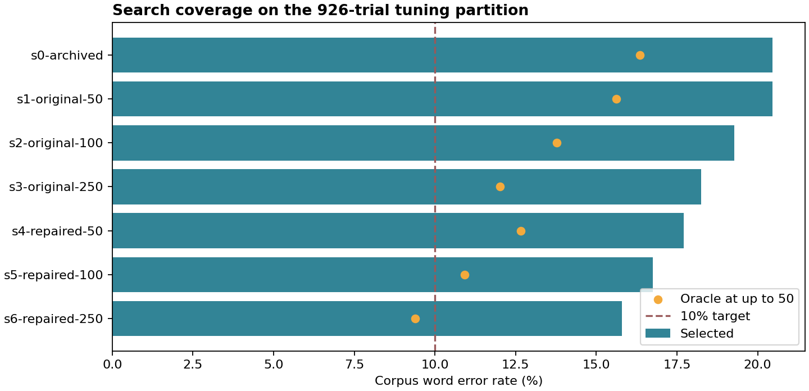
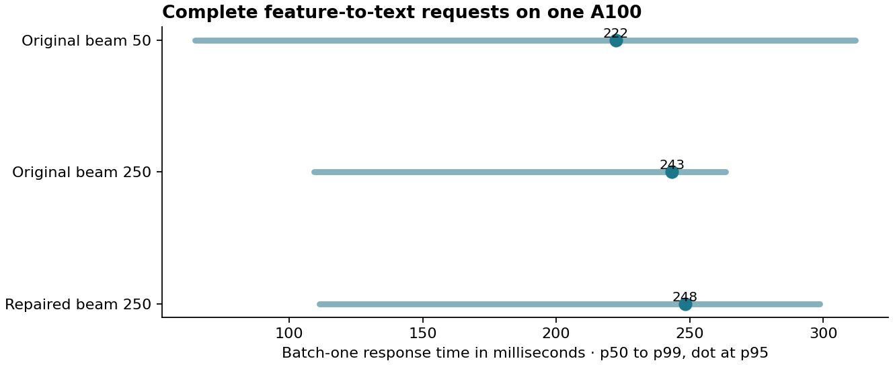

# Accuracy and efficiency continuation

The frozen v1 analysis remains available at its [release revision](https://github.com/Clement-Wright/BTT-25-CW/blob/fe5fb4081f2ce256b41ba2a91f104a6a64a53deb/reports/results.md). Its every-trial DistilGPT2 condition scored 17.67% WER on the 500-trial `dev_report` selection and 18.21% on full validation. Those results informed this continuation. V2 development uses the same 926-trial `dev_tune` partition. Any v2 report score on the existing benchmark will be exploratory.

## Candidate coverage

The first comparison holds the official GRU emissions, decoder thresholds, lexicon, and training-only KenLM weights fixed. Each new arm saved all 1,426 validation hypotheses before scoring the tuning slice. Oracle cells use rankings from the actual distinct candidates returned. A failed or empty hypothesis would contribute its full word deletions to the corpus count.

| Decoder | Selected edits | Selected WER | Oracle@10 | Oracle@25 | Oracle@50 |
| --- | ---: | ---: | ---: | ---: | ---: |
| Archived beam 50, 10 requested | 1,234 | 20.45% | 16.34% | 16.34% | 16.34% |
| Original beam 50, 50 requested | 1,234 | 20.45% | 16.34% | 15.65% | 15.61% |
| Original beam 100, 50 requested | 1,163 | 19.28% | 15.12% | 14.16% | 13.77% |
| Original beam 250, 50 requested | 1,101 | 18.25% | 14.01% | 12.78% | 12.02% |
| Repaired beam 50, 50 requested | 1,068 | 17.70% | 13.36% | 12.68% | 12.66% |
| Repaired beam 100, 50 requested | 1,011 | 16.76% | 12.28% | 11.27% | 10.92% |
| Repaired beam 250, 50 requested | 953 | 15.80% | 11.22% | 10.00% | 9.38% |

Each row uses 6,033 reference words. The original beam-250 row made 217 fewer oracle errors than the new original beam-50 list. The repair at beam 250 cut selected errors by another 148 and oracle errors by 159. Its top 50 oracle makes 566 edits, which clears the 10% threshold by 37 edits. The 387-edit ranking gap to the selected output is specific to this tuning set and its saved list. The archived list has at most ten candidates, so all higher oracle cutoffs reuse that list.

The native trie audit found that a six-label terminal cap dropped 224 pronunciation entries and made 208 word types unreachable. Nine of those types appeared 1,414 times in training, including 1,324 instances of `you`. The repair retained all 134,711 pronunciations and reduced tuning lexicon OOVs from 144 to 3 word tokens. KenLM OOVs remained at 402 tokens because the three-gram stayed fixed. [Registration and commands](../docs/CONTINUATION.md)

At beam 250, the largest change came from Switchboard with 130 fewer errors over 4,569 words. Random-word trials tied at 76 errors over 200 words. Harvard sentences had three additional errors over 201 words. These corpus slices share the 926-trial tuning scope and the same neural logits. [Corpus and session counts](continuation.json)

## Complete requests on the laptop

The laptop benchmark used the official encoder on an RTX 3080 Laptop GPU and the Windows-compatible ZeroLM lexicon decoder. It timed released feature reads, transfer, smoothing, encoder completion, native search, and final text selection. Across three interleaved warm passes, each beam completed 288 requests on the same 96 length-sampled tuning trials. Batch size was one. References stayed closed, and the benchmark ran offline.

| ZeroLM beam | p50 | p90 | p95 | p99 | Max | Real-time factor |
| --- | ---: | ---: | ---: | ---: | ---: | ---: | ---: |
| 50 | 66.7 ms | 105.2 ms | 127.9 ms | 146.1 ms | 158.1 ms | 0.00392 |
| 100 | 96.2 ms | 152.5 ms | 184.5 ms | 219.2 ms | 238.0 ms | 0.00572 |

Combined process-tree RSS peaked at 1.53 GB with both decoder processes resident. Device-wide use peaked at 2.28 GB. The encoder process reported a 0.37 GB PyTorch allocated peak and 1.07 GB reserved peak. Cold checkpoint setup took 1.11 s. The two native services became ready in 2.11 s and 2.02 s. ZeroLM timing describes that laptop configuration. The matched KenLM and neural-LM systems use the Gilbreth allocations.

The original beam-250 cached-logit job charged up to 1.35 GB to its job cgroup, with process RSS around 0.28 GB. Its 15,000 MiB Slurm request set an effective host limit of 15,728,640,000 bytes. Cgroup charge includes the file cache and is reported separately from process RSS. [Aggregate counts and timings](continuation.json)

## Matched complete-pipeline timing on Gilbreth

Three interleaved warm passes timed the same 96 feature trials across three search configurations on one A100 40 GB allocation with four CPUs. The encoder ran in FP32 and synchronized each GPU phase. All 864 requests returned text. The real-time factor divides total completed request time by original input duration in 20 ms bins.

| System | p50 | p90 | p95 | p99 | Max | Real-time factor |
| --- | ---: | ---: | ---: | ---: | ---: | ---: | ---: |
| Original beam 50 | 64.7 ms | 135.5 ms | 222.4 ms | 312.1 ms | 488.0 ms | 0.00446 |
| Original beam 250 | 109.3 ms | 220.0 ms | 243.3 ms | 263.4 ms | 320.8 ms | 0.00699 |
| Repaired beam 250 | 111.3 ms | 230.7 ms | 248.3 ms | 298.6 ms | 313.7 ms | 0.00706 |

Repaired beam 250 completed 7.74 requests per second of request time. Cold encoder initialization took 6.26 s within the Python benchmark. The combined allocation with three resident decoder services peaked at 3.11 GB cgroup charge, 1.41 GB summed RSS, and 1.61 GB device-wide GPU use. The PyTorch process peaked at 0.36 GB allocated and 1.07 GB reserved. The shared-resource figures cover the whole harness and cannot be assigned to individual arms. [Length-stratified timings and counters](continuation.json)

## LightBeam with in-search fusion

The pinned LightBeam run decoded a fixed length-stratified subset of 24 `dev_tune` trials. It saved text and phones for every trial in each arm. Twenty passes completed 1,440 decoder requests in 940.55 warm seconds. Only the first pass contributed to word errors. Qwen3-1.7B-Base scored exact candidate tokens inside the Gilbreth A100 allocation. This uses the same final scorer in both neural arms and the published search backend with our own settings and assets. [LightBeam paper](https://arxiv.org/html/2603.14002v1)

| Condition | Word edits / 156 | WER |
| --- | ---: | ---: |
| LightBeam with training-only three-gram | 31 | 19.87% |
| LightBeam with final-only Qwen | 30 | 19.23% |
| LightBeam with periodic and final Qwen | 23 | 14.74% |
| Original compact beam 50 on the same trials | 25 | 16.03% |
| Repaired compact beam 250 on the same trials | 23 | 14.74% |

Periodic fusion had nine fewer deletions and two more substitutions than final-only scoring. Three trials improved and one worsened. Repaired compact made 21 substitutions and two insertions. Periodic LightBeam made 20 substitutions and three deletions. The subset result does not establish a broader WER improvement.

The periodic arm scored 527,000 target tokens across the timing passes, compared with 50,220 for final-only. Its cached-logit p95 was about 1.98 s, versus 0.79 s for final-only. The job peaked at 2.77 GB of cgroup charge, 4.12 GB of summed process RSS and 4.81 GB of device-wide GPU use. Shared memory can appear more than once in RSS. Cold initialization took 121.75 s. The periodic arm matched the simpler repaired search on this common subset, so this configuration remains a feasibility study. [LightBeam measurements](continuation.json)
