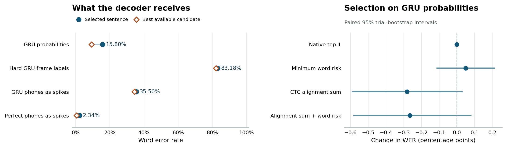
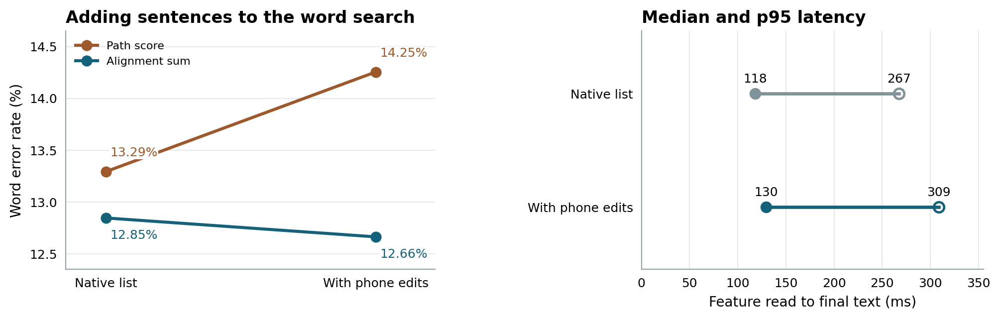

# How much does the word decoder depend on uncertain phones?

The official GRU reached **764 word edits across 6,033 words (12.66% WER)** on 926 development sentences when the decoder added word candidates within one phone edit of its predictions, summed CTC alignments, and used DistilGPT2 to score the text. The compact decoder made **953 edits (15.80%)** on the same GRU probabilities. With the reference phones and word-boundary SIL tokens supplied to that compact search, it made **141 edits (2.34%)**. The latter change was 13.46 percentage points, with a paired-trial bootstrap interval of 12.23 to 14.68 points. All three runs returned text on every trial.



| Phone evidence given to the compact decoder | Greedy phone edits / 26,680 | Word edits / 6,033 | WER | Best candidate in each list |
|---|---:|---:|---:|---:|
| Original GRU probabilities | 2,669 | 953 | 15.80% | 566 edits (9.38%) |
| Top GRU phone or blank at every original frame | 2,669 | 5,018 | 83.18% | 4,955 edits (82.13%) |
| Same predicted phones, evenly spaced spikes | 2,669 | 2,142 | 35.50% | 2,076 edits (34.41%) |
| Reference phones, evenly spaced spikes | 0 | 141 | 2.34% | 32 edits (0.53%) |

The three GRU inputs have exactly the same **10.00% greedy PER**. The full probabilities let search recover from wrong first choices. Forcing one phone or blank per frame to have logit zero and all alternatives to −100 keeps the original timing, yet substitutions rise from 883 to 3,897 and insertions from 55 to 1,080. The 83.18% result measures that particular saturation stress test. A decoder intended for hard symbols would need a model of phone mistakes or a different interface.

Retiming those hard GRU phones as isolated spikes recovers much of the lost accuracy. Supplying the correct phones at the same constructed timing reduces WER further, from 35.50% to 2.34%. The injection also gives the decoder the true SIL sequence. It changes confidence and timing together relative to the live GRU and requires the tuning labels. All 926 constructed sequences fit the original frame count. The oracle column selects the candidate with the fewest edits after seeing the transcript. It measures what the returned lists contain.

The compact search used the repaired Flashlight trie, beam 250, at most 50 unique sentences, and the training-only KenLM 3-gram with natural-log weight 2. It returned an average of 34.7 unique sentences per trial on normal GRU emissions. An independent native replay disagreed with the archived top text on three trials and with its candidate membership on 19. The normal-input comparisons use the archived candidate identities and scores. The sorted trial/emission-hash manifests match exactly across the archived search and neural inference.

## How the new selectors work

For a candidate pronunciation, CTC can sum the probabilities of every compatible frame alignment. The decoder saves one retained phone string per unique sentence. Our explicit compact score adds the CTC log probability of that string to the weighted KenLM sentence log probability. Alternative pronunciations that the search discarded remain outside the sum. A separate ablation adds back Flashlight’s native merge-score residual. The two conditions have distinct entries in the aggregate evidence. [CTC formulation](https://www.cs.toronto.edu/~graves/icml_2006.pdf)

The minimum-risk selector computes edit distances between candidate sentences, applies a softmax to their scores at fixed temperature 2, and picks the sentence with the lowest expected number of word edits. The transcript plays no part in that choice. The softmax approximates a posterior over the returned list. [N-best word error minimization](https://www.isca-archive.org/eurospeech_1997/stolcke97_eurospeech.html)

The extra word proposals start from predicted SIL boundaries. Within each segment, the dictionary lookup allows one phone insertion, deletion or substitution. Common voiced/unvoiced pairs get a smaller substitution penalty. A training-only trigram scores continuations, and exact CTC phone scores compare the resulting sentences with the original list. The registered limits are 16 alternatives per segment, a sentence beam of 32 and at most 25 proposed sentences. Several spellings can share a pronunciation. A missing or extra boundary can still put the correct word outside this search. Pronunciation rewrite rules have a longer history in speech recognition. [Pronunciation modeling with rewrite rules](https://www.isca-archive.org/pmla_2002/hazen02_pmla.html)

## Better word choices from the same neural recordings

With the same 25-candidate limit and the same recorded DistilGPT2 scores, summing CTC alignments cut word errors from **802 to 775 (13.29% to 12.85%)**. It helped 34 trials and harmed 12. The rest had the same edit count. The paired 95% interval for the change was −0.71 to −0.20 percentage points. The model made 83 errors on 200 random words, one more than its path-scored control. Replacing the acoustic score also helped both larger Qwen models, although the ordering of the models persisted.

| Language prior | Original path score | Path score + minimum word risk | CTC alignment sum | CTC sum + minimum word risk |
|---|---:|---:|---:|---:|
| DistilGPT2 | 802 (13.29%) | 801 (13.28%) | **775 (12.85%)** | 778 (12.90%) |
| Qwen3.6 35B-A3B | 840 (13.92%) | 840 (13.92%) | 821 (13.61%) | 817 (13.54%) |
| Qwen3.8 27B | 846 (14.02%) | 851 (14.11%) | 830 (13.76%) | 828 (13.72%) |

Every entry uses 6,033 reference words. Each neural prior contributes its previously measured log-likelihood at weight 1.25. The trigram proposes candidates. Its score drops out of the final decision for this table. All original top-1 counts reproduced exactly. The neural priors’ general training-data overlap with these transcripts remains unknown.

With the compact trigram alone, native top-1 made 953 errors, minimum word risk made 956, explicit CTC alignment sum made 936, and applying minimum risk to the latter made 937. The paired interval on 936 versus 953 ranged from −0.59 to +0.03 percentage points.

| Phone input and candidate list | Returned sentences across 926 trials | Selected errors | Oracle errors |
|---|---:|---:|---:|
| GRU, native list | 32,160 | 936 (15.51%) | 566 (9.38%) |
| GRU, with one-edit proposals | 45,869 | 927 (15.37%) | 540 (8.95%) |
| Perfect spikes, native list | 18,821 | 142 (2.35%) | 32 (0.53%) |
| Perfect spikes, with one-edit proposals | 37,372 | 133 (2.20%) | 19 (0.31%) |

Both rows within each pair use the same CTC scorer and training ARPA model. On normal GRU input the proposals introduced new sentences on 737 trials. Candidate coverage improved by 26 edits, with a paired interval of −0.61 to −0.27 percentage points. Selection recovered nine edits, with an interval of −0.33 to +0.02 points. On the random-word corpus, adding candidates changed the oracle from 51 errors to 50 and left selected errors at 77. This compact experiment starts from up to 50 native candidates. The neural-prior comparison below starts from up to 25.

Job 12625838 checked all 47,416 distinct candidate texts from the normal and perfect-phone lists against KenLM’s compiled `query` program. The ARPA reader matched within 0.000048 weighted natural-log units on every sentence. Flashlight’s saved LM component differed from the direct sentence score by more than one natural-log unit for 36 of 50,981 candidate occurrences, with a maximum difference of 13.00. The cause remains unresolved. The one-edit rows use the independently verified sentence score for both lists.

## Expanded lists with DistilGPT2

The final comparison retained the original 25-candidate limit, added at most 25 distinct proposed sentences, and held the LM weight at 1.25. Across 926 trials it reused 18,645 archived likelihoods and scored 14,279 additional sentences containing 120,533 scored tokens. The original path and alignment-sum conditions reproduced the earlier 802 and 775 edits exactly.

| Sentence list | Acoustic scoring rule | Selected word errors | WER | Oracle errors | Errors on 200 random words |
|---|---|---:|---:|---:|---:|
| Original | Retained path | 802 | 13.29% | 603 | 82 |
| Original | Alignment sum | 775 | 12.85% | 603 | 83 |
| Expanded | Retained or proposed path | 860 | 14.25% | 574 | 81 |
| Expanded | Alignment sum | **764** | **12.66%** | 574 | 81 |

Adding candidates improved the oracle from 9.995% to 9.514%, but it made path-based selection worse. An original candidate keeps the native search path score. A new pronunciation gets the score of its highest-probability valid CTC path. In the other column both sources use sums over alignments. Repeated text gets the higher acoustic score of its available pronunciations. Neither rule sums across spellings or counts the LM twice.

On the two alignment-scored lists, adding candidates helped 17 trials and harmed six. The 11-edit reduction has a paired 95% interval of −0.36 to −0.03 percentage points by trial and −0.38 to 0.00 across the 43 session/block groups. Against the original path scorer the expanded alignment rule saved 38 edits, with a block interval of −0.95 to −0.34 points. Its remaining gap is 2.66 points above 10% on this exposed development split. The oracle still had 190 fewer edits than the selected output.

At most 603 word edits would reach 10% on these 6,033 words. A selector confined to these lists would have to recover 161 of the 190 avoidable edits. That is a narrow margin. A next comparison could train a pronunciation-aware ranker on out-of-fold predictions from official training trials, retain the present selector as its control, and freeze both before scoring eligible new recordings. That comparison would need to document which recordings each encoder had seen.



Job 12626215 ran both alignment-scored systems on the same A100 80 GB PCIe with four allocated CPU cores. Each request read one released HDF5 feature trial, ran the official GRU, searched for words, scored all its candidates on the GPU, and selected final text. The expanded system also generated its phone-edit candidates inside that request. Each of 24 length-stratified trials was timed three times, alternating the two systems. All 144 measured requests produced their archived text.

| Matched offline decoder | p50 | p90 | p95 | p99 | Maximum | Pooled RTF |
|---|---:|---:|---:|---:|---:|---:|
| Original list, alignment + DistilGPT2 | 118 ms | 259 ms | 267 ms | 371 ms | 572 ms | 0.00752 |
| Expanded list, alignment + DistilGPT2 | **130 ms** | 265 ms | **309 ms** | 377 ms | 523 ms | **0.00846** |

The expanded system processed 6.36 complete utterances per second in this replay. Cold shared setup took 81.35 seconds. Both systems together peaked at 3.31 GB job memory including file cache and 1.83 GB process-tree RSS. PyTorch allocated at most 0.54 GB on the GPU and reserved 1.02 GB. Device-wide usage peaked at 1.56 GB. These numbers describe this allocation. The measured system returns one final text per complete trial. Its 80 ms phone update period and post-recording computation time do not establish a live word-commit cadence. [Timing, paired effects and per-corpus results](expanded_phone_words.json)

Job 12626394 then ran the expanded system alone on the official hidden test. It produced **1,450 nonempty predictions in official order** without reading any trial labels. Slurm wall time was 4 min 59 s on one A100 80 GB PCIe and four CPU cores. Peak job memory including file cache was 4.43 GB and peak PyTorch GPU allocation was 0.53 GB. The CSV passed a second ID, text and hash check after transfer. Its SHA-256 is `746812ba2b8f0bf2a40ffff25626b43518270ee8f3629b3a8f6e992db80a4da4`. This verifies export coverage. A hidden-test WER would require external labels.

## Compute and scope

| Gilbreth job | Work inside the resource monitor | Wall time inside monitor | Peak job memory including file cache | Peak process-tree RSS |
|---|---|---:|---:|---:|
| 12625458 | Four phone inputs, 3,704 searches and four selection rules | 508 s | 1.72 GB | 0.86 GB |
| 12625459 | Cached LM scores and explicit compact scoring | 24 s | 0.65 GB | 0.57 GB |
| 12625561 | Extra word proposals and matched original list | 30 s | 1.81 GB | 0.83 GB |

These runs used two allocated CPU cores and 9,000 MiB of requested host memory. Gilbreth allocated a standby GPU to each job. This decoder and the cached-score analysis ran their arithmetic on CPU. The earlier DistilGPT2 and Qwen GPU forward passes produced the cached scores. On normal GRU probabilities the native search took 96 ms at p50 and 308 ms at p95. Generating and scoring the additional word candidates took 16 ms at p95 in its separate job. These are offline component measurements from cached emissions. They exclude the encoder and live language-model execution.

The `dev_tune` split was already exposed during development. The paired intervals resample whole trials 2,000 times and express uncertainty conditional on this development population. The benchmark has one participant. The hidden-test score and live spelling latency cannot be estimated from these runs.

## Reproduce on the established Gilbreth workspace

Stage this checkout’s `src`, `scripts`, `configs`, and `hpc` folders under `$RCAC_SCRATCH/btt-25-cw/v4-rate-20261127/phone-robustness-code`. The first job also imports the established v3 decoder service with the repaired native binding. The frozen v2/v3 run IDs in the launchers identify the emissions, first-pass candidates, and neural-prior caches.

```bash
cd "$RCAC_SCRATCH/btt-25-cw/v4-rate-20261127/phone-robustness-code"
source_job=$(sbatch --parsable hpc/gilbreth_v4_phone_robustness.sh)
sbatch --dependency="afterok:$source_job" hpc/gilbreth_v4_phone_priors.sh "$source_job"
sbatch --dependency="afterok:$source_job" hpc/gilbreth_v4_phone_edits.sh "$source_job"
```

For new recordings that follow the released T15 feature contract, the fixed decoder can read an official validation or test manifest directly. The inference command takes the trained GRU, registered lexical assets and DistilGPT2 revision, and reconstructs its word-frequency counts from the allowed training transcript file. Its inputs contain no previously scored candidates. Use the project’s allocated Gilbreth environment with the repaired Flashlight binding and shared-library paths from the launcher. [Reference-free inference launcher](../hpc/gilbreth_v4_expanded_export.sh)

```bash
python -m btt25.phone_word_inference --config configs/local.yaml \
    --registration configs/phone_edit_neural_v4.json \
    --proposal-config configs/phone_edit_candidates_v4.json \
    --lexicon assets/local/lexicon.txt --distil assets/local/distilgpt2 \
    --training-text runs/compact-a100/lm/train-normalized.txt \
    --train-lm-manifest runs/compact-a100/lm/manifest.json \
    --arpa runs/compact-a100/lm/train-3gram.arpa \
    --kenlm-model runs/compact-a100/lm/train-3gram.binary \
    --decoder-python "$DECODER_PYTHON" --decoder-module-path "$FLASHLIGHT_MODULE_PATH" \
    --partition test --output runs/expanded-test
```

All three runs saved trial-level predictions, resolved configurations, asset hashes, resources, and scheduler receipts to project scratch. The machine-readable aggregate includes all sessions and corpora. Job 12625302 stopped before decoding because its batch environment lacked the scratch variable. Job 12625406 stopped at the first native-replay mismatch and saved 1,096 condition rows. The completed comparison uses the verified archive and records all replay disagreements. [Aggregate evidence](phone_robustness.json)
