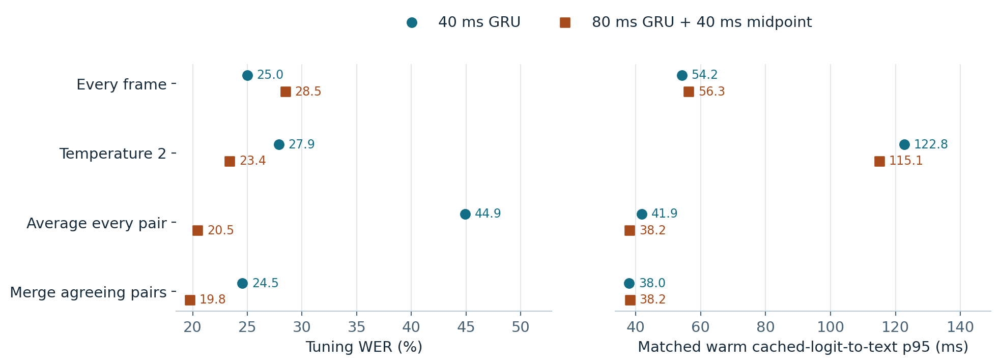

# Let the word search skip redundant frames

The two-rate model made **1,192 word edits over 6,033 tuning words (19.76% WER)** when we averaged neighboring frames only if both put the same phone or blank first. Searching every 40 ms frame made **1,719 edits (28.49%)**. Both emitted exactly the same greedy phone sequence on all 926 scored trials. Pairing cut the number of frames sent to word search by 47.8% across validation. In three matched warm passes, cached-logit-to-text p95 fell from 56.3 to 38.2 ms. The matched 80 ms GRU still had lower WER at 17.92%. [Clock and error analysis](cadence_v4.md)

| Encoder | Input to word search | Word edits / 6,033 | WER | PER | Frames kept | Matched cached p95 |
|---|---|---:|---:|---:|---:|---:|
| 40 ms GRU | Every frame | 1,507 | 24.98% | 13.56% | 100% | 54.2 ms |
| 40 ms GRU | Temperature 2 | 1,682 | 27.88% | 13.56% | 100% | 122.8 ms |
| 40 ms GRU | Average every pair | 2,710 | 44.92% | 24.73% | 50.1% | 41.9 ms |
| 40 ms GRU | Merge agreeing pairs | 1,481 | 24.55% | 13.56% | 54.2% | 38.0 ms |
| Two-rate GRU | Every frame | 1,719 | 28.49% | 11.90% | 100% | 56.3 ms |
| Two-rate GRU | Temperature 2 | 1,411 | 23.39% | 11.90% | 100% | 115.1 ms |
| Two-rate GRU | Average every pair | 1,234 | 20.45% | 11.30% | 50.1% | 38.2 ms |
| Two-rate GRU | Merge agreeing pairs | 1,192 | 19.76% | 11.90% | 52.2% | 38.2 ms |

Each model supplies one 41-class posterior every 40 ms. The two-rate model updates its GRU every 80 ms and predicts the intervening posterior from the previous state and recent input. Temperature 2 halves each pairwise logit difference without changing the winning phone. Averaging every pair can erase a brief phone between blanks. The agreement rule preserves both frames on a disagreement, including transitions between a phone and a blank. All conditions kept the same lexicon, training-only 3-gram, natural-log LM weight of 2 and beam of 50. Earlier speech-recognition research used blank-dominated spans to reduce CTC search work. Here the agreement can concern any of the 41 classes. [Fixed study design](../docs/RATE_DECODER_V4.md) · [Blank Collapse](https://arxiv.org/abs/2210.17017)

The agreement rule saved 527 word edits in the two-rate model. The paired WER change was −8.74 percentage points, with a 95% session/block bootstrap interval of −10.11 to −7.39. The same rule saved 26 edits in the conventional 40 ms GRU (−0.43 points, interval −1.27 to +0.35). The relative weight of neighboring soft phone estimates mattered more for the two-rate encoder. Averaging every pair removed much more phone evidence from the conventional GRU, raising its phone errors from 3,617 to 6,597. These observations apply to the tuning trials and the fixed word search.

## Coverage and timing

Both trained checkpoints supplied cached logits for all 926 tuning trials. We generated the missing 500 validation emissions per encoder without reading labels. All eight conditions saved 1,426 blind predictions in official validation order before scoring the tuning IDs. Each private prediction has its text, greedy phones, status, raw and decoded frame counts, and measured latency. We retained all empty hypotheses in corpus scoring. The figure and table use p95 across the same 72 warm requests per condition, comprising three passes over 24 trials after one complete warm-up pass. The aggregate also records p95 over the full 1,426-trial validation pass. Each request starts at the cached logit file read and ends at final word selection. The separate feature-to-text benchmark includes encoder execution.

Across both encoders and all search conditions, the shared blind-inference and decoding job peaked at 2.585 GB of cgroup memory (including file cache), 0.924 GB sampled process-tree RSS and 0.403 GB of PyTorch GPU allocations. These are different measurements of one combined job. The 900.01-second pilot completed 24,156 requests. It forecast 733 more seconds including margin, with 5,040 seconds available. [Aggregate metrics, separate timing populations and resource receipts](rate_decode_v4.json)

## Replay audit

The original trained-model search and the new native search returned different top texts on 22 of 926 trials for the 40 ms GRU and 41 of 926 for the two-rate model. Their greedy phones matched everywhere. Archived word totals were 1,506 and 1,721 edits, compared with 1,507 and 1,719 in the fresh run. We verified the checkpoint, emission, lexicon, language-model and split identities, the search settings, every transformed phone sequence, and the contributing word edits. The underlying reason for the native search differences remains unresolved. Each comparison above pairs a transformation with the native search from that same decoding process.

Gilbreth job 12625509 stopped at scratch setup. Job 12625921 produced the 11,408 blind predictions, then stopped when its strict replay check encountered a different top text. Job 12627501 completed the score-only audit of those saved outputs. It performed no search or training. Its per-trial disagreement file, all predictions and the trained checkpoints remain on project scratch.

To replay the same inputs on the established Gilbreth workspace, stage the decoder and its launcher as described in the runbook and supply the successful model task IDs. Run the audit against a fresh output directory if the strict lexical replay assertion stops an otherwise complete blind decode. The original prediction files are preserved and hash-checked. [Runbook](../docs/REPRODUCE_RATE_STUDY.md) · [Decoder](../src/btt25/v4_rate_decode.py) · [Score-only audit](../src/btt25/v4_rate_replay_audit.py)
