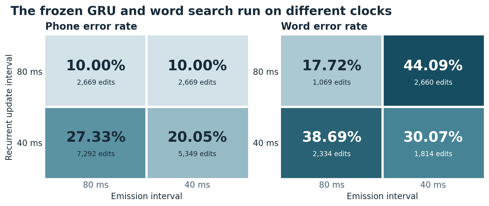
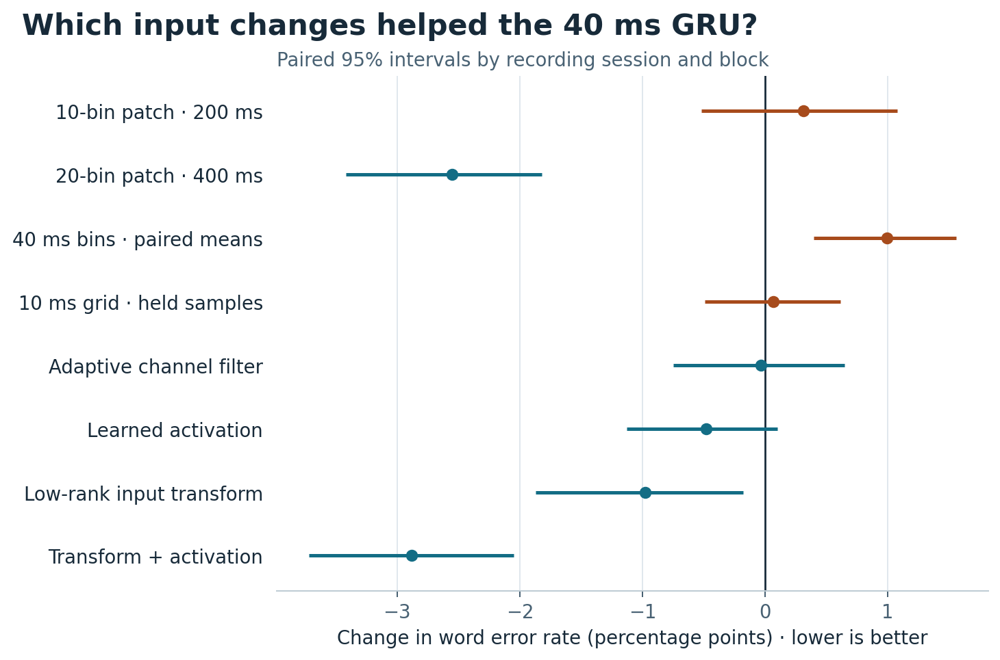
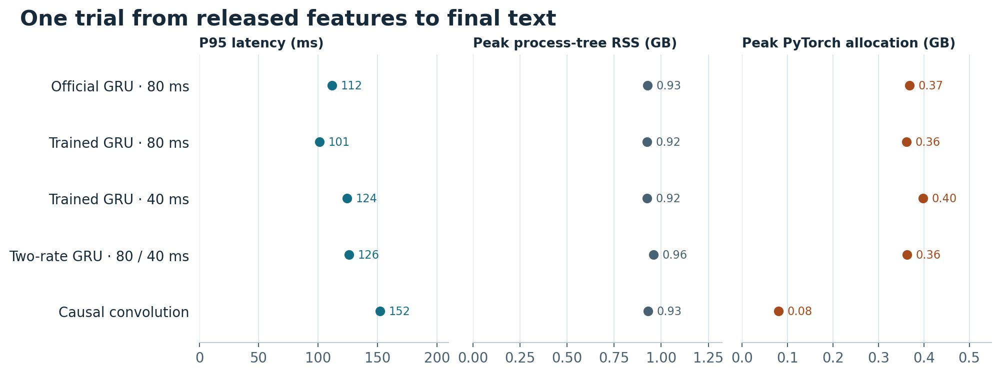
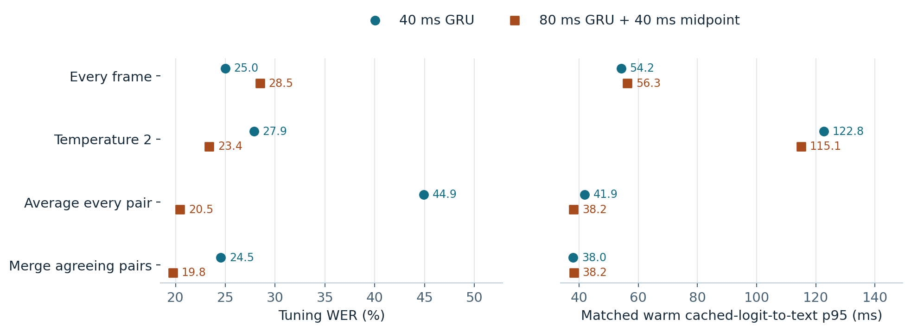
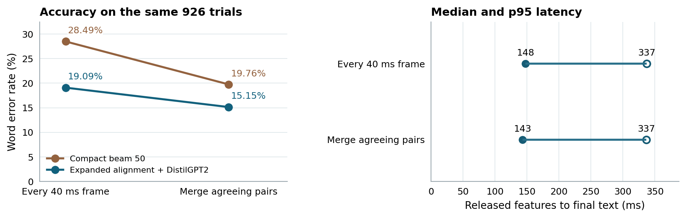

# When should the decoder update its phones?

Training at the faster clock helped, but 80 ms still gave the best word accuracy among the matched recurrent controls. At 40 ms, the two-rate model made **442 fewer phone errors** than the GRU that updated its entire state every 40 ms. The same word decoder then made **215 more word errors** with those two-rate outputs. A second search experiment recovered much of that loss by merging neighboring frames that agreed on the most likely class. Two-rate WER fell to **19.76%** with the same greedy phones.

All encoder scores below use the same 926 T15 tuning trials, 26,680 target phones including SIL, and 6,033 transcript words. Each trained model saw the same 2,048 single-trial updates from official training data. The official GRU had already seen all 45 sessions during its original development. These results describe an exposed development benchmark.

| Encoder or input change | Phone edits | PER | Word edits | WER |
|---|---:|---:|---:|---:|
| Official GRU, 80 ms | 2,669 | 10.00% | 1,069 | 17.72% |
| Adapted GRU, 80 ms | 2,772 | 10.39% | 1,081 | 17.92% |
| Adapted GRU, 40 ms | 3,617 | 13.56% | 1,506 | 24.96% |
| Adapted GRU, 20 ms | 5,950 | 22.30% | 2,154 | 35.70% |
| 80 ms recurrence, learned 40 ms emissions | 3,175 | 11.90% | 1,721 | 28.53% |
| 10-bin patch, 40 ms emissions | 3,710 | 13.91% | 1,525 | 25.28% |
| 20-bin patch, 40 ms emissions | 3,482 | 13.05% | 1,352 | 22.41% |
| 40 ms bins from paired averages | 3,610 | 13.53% | 1,566 | 25.96% |
| 10 ms grid from held samples | 3,657 | 13.71% | 1,510 | 25.03% |
| Trainable channel-wise smoother | 3,592 | 13.46% | 1,504 | 24.93% |
| Learned softsign/tanh mixture | 3,598 | 13.49% | 1,477 | 24.48% |
| Low-rank input transform | 3,400 | 12.74% | 1,447 | 23.98% |
| Input transform and learned activation | 3,280 | 12.29% | 1,332 | 22.08% |
| Compact causal convolution | 13,152 | 49.30% | 4,752 | 78.77% |

These rows use repaired beam-50 search and the same train-only three-gram. The stronger word decoder has a separate comparison below.

## Two changes hidden inside a stride change

With the official weights fixed, we first changed only what the word decoder received. Repeating the 80 ms logit rows on a 40 ms grid left the collapsed phone sequence identical on every trial. Word errors increased from 1,069 to 2,660. Extra frames change which alignments the lexical search can take and how much evidence accumulates for a word.

We then passed the intervening patches through the frozen recurrent layers. Keeping only the resulting 80 ms anchor frames produced 7,292 phone errors, including 3,853 deletions. The ordinary 80 ms run had 505 phone deletions. Keeping all the fast outputs recovered some of those missing phones, but insertions rose to 2,337 against 296 at the native update rate. Advancing the same cell twice as often changes its state, and a phone can move onto a frame that the anchor-only view discards. This experiment measures model timing. The labels do not locate phoneme onsets in the recording.

The new intermediate head keeps the previous 80 ms GRU state and reads the change in the newest four transformed bins. Its zero-initialized residual starts by repeating the preceding logit row. The head, the top two GRU layers and the output projection then train against the 40 ms CTC objective. The direct 40 and 80 ms controls train the same recurrent layers and output projection. A 14-bin patch spans 280 ms after smoothing. With the nine-bin valid kernel, the first complete input window ends at 440 ms.

At a trained 20 ms stride, 92.84% of frames ranked blank first, compared with 74.92% at 80 ms. The denser model had 30.97 frames per minimum feasible CTC target frame, four times the 80 ms control's 7.75. Yet it deleted 2,164 phones against 595. Giving the model more output positions did not solve its alignment problem. There were no immediately repeated identical target phones in this tuning partition, so the experiment cannot isolate recognition of that specific pattern. [Error counts by phone and session](cadence_v4.md) · [PER by transcript density](figures/rate_phone_density.png)

The convolutional comparison represents a patch by its average level and the difference between its two newest pairs of bins. Six depthwise dilated convolutional blocks then carry up to 127 emission positions of prior context. Its 656,297 trainable parameters learn from the true training phone sequences and a soft target supplied by the official GRU on the same training trials. It inherits the session-transform weights. Its 78.77% WER measures this particular student and training budget.

## Which inputs helped?

Among the GRUs trained to advance every 40 ms, a wider window helped. Moving from 14 to 20 acquired bins saved 154 word edits, **2.55 percentage points** (paired 95% session/block interval, 1.82 to 3.42 points lower). It also delayed the first complete input window from 440 to 560 ms. Ten bins gave a 360 ms first window and 19 extra word edits. The changed patches are linearly mapped to 14 positions before entering the pretrained GRU input weights.

Keeping the patch span at 280 ms while averaging pairs into 40 ms bins cost 60 word edits. Repeating each real 20 ms feature on a 10 ms grid cost four edits (paired interval −0.49 to +0.61 points). This release cannot measure the value of genuinely acquiring spikes at 10 ms. The low-rank input transform plus learned activation saved 174 word edits against the direct 40 ms control, **2.88 points** (2.05 to 3.72 lower).

The adaptive smoother alone saved two edits, with a paired session/block interval from 0.75 points lower to 0.65 points higher. Its nine-tap Gaussian initialization had a full width at half maximum of 95.12 ms. After training, the median width across the 512 channels was 95.47 ms when a window's endpoints had equal values. With an absolute endpoint difference of three standardized units, the median was 95.64 ms and the middle 80% of channels spanned 93.24–98.05 ms. At this budget the learned filter stayed close to the original across both tested input differences. [Learned taps, widths and activation coefficients](cadence_v4.md#what-did-the-learned-filter-change)

In the earlier multiview comparison the dense raw/light/Gaussian residual saved one word edit against its matched head-only control at 256 updates. [Earlier smoothing and fusion results](temporal.md)

## Cost of a phone update

All 14 systems ran on the same A100-SXM4-40GB with four CPU cores. We rotated model order across three warm passes over 24 duration-stratified recordings per model, starting each request at the HDF5 read and stopping after the decoder returned final text. Every request used a batch of one.

| Beam-50 system | Median | P95 | Real-time factor | Peak process-tree RSS | Peak PyTorch GPU allocation |
|---|---:|---:|---:|---:|---:|
| Official 80 ms GRU | 51 ms | 112 ms | 0.0030 | 0.93 GB | 0.37 GB |
| Trained 80 ms | 50 ms | 101 ms | 0.0029 | 0.92 GB | 0.36 GB |
| Trained 40 ms | 77 ms | 124 ms | 0.0042 | 0.92 GB | 0.40 GB |
| Trained 20 ms | 135 ms | 272 ms | 0.0077 | 0.92 GB | 0.47 GB |
| Two-rate | 60 ms | 126 ms | 0.0035 | 0.96 GB | 0.36 GB |
| Causal convolution | 88 ms | 152 ms | 0.0051 | 0.93 GB | 0.08 GB |

The two-rate model reduced median latency and GPU allocation relative to the direct 40 ms GRU. Their p95 values were within 2 ms. Across all systems, 52 of the 1,008 warm requests returned text that differed from the saved corpus run. For the direct 40 ms model that happened on 10 of 72 requests, for the two-rate model on 3 of 72, and for the unchanged GRU on none. The accuracy table uses the full saved corpus run. The latency and replay differences come from the separate timing passes.

Peak cgroup charge over the entire inference job was 3.61 GB. That high-water mark is shared across models in the allocation. During training, each arm ran in its own allocation. The highest observed training-job cgroup charge was 10.43 GB and the largest PyTorch GPU allocation was 1.15 GB. Every admitted training pilot lasted at least 900 seconds. The aggregate includes cold setup, all latency percentiles, length strata, per-condition memory, hardware, trial coverage, checkpoint hashes and paired error intervals. [Complete accuracy and resource measurements](rate_v4.json) · [All encoder accuracy rows, plotted](figures/v4_rate_models.png)

## How often should word search see a new frame?

The two-rate encoder supplies a new 41-class distribution every 40 ms. We paired adjacent frames and averaged their probabilities only when the same class ranked first in both. A disagreement, including a phone-to-blank transition, sent both frames through. This retained 52.2% of the validation frames. On the 926 tuning trials, the two-rate decoder made 1,192 word edits with this rule and 1,719 when it searched every frame. The reduction from 28.49% to 19.76% WER is **8.74 percentage points**, or **30.7% fewer word edits**. The 95% paired session/block interval was 7.39 to 10.11 points lower. Greedy PER stayed at 11.90%. The trained 80 ms GRU still scored 17.92% WER.

The conventional 40 ms GRU gained much less from the same rule, going from 1,507 to 1,481 word edits (−0.43 percentage points, interval −1.27 to +0.35). Averaging every pair without checking for agreement raised its WER to 44.92%. Halving the logit differences while keeping all frames helped the two-rate decoder and hurt the conventional GRU. The two encoders therefore called for different treatment of uncertainty even though they emitted at the same rate.

Across three warm passes over 24 trials, the two-rate model's cached-logit-to-text p95 fell from 56.3 to 38.2 ms with agreement-based merging. The plot uses the same 72 warm requests per condition. The linked aggregate also includes p95 over the full validation pass. All eight conditions saved blind word predictions across that partition. On tuning, fresh native search differed from the training-run top text on 22 conventional GRU trials and 41 two-rate trials. Across 6,033 reference words, the fresh controls made one more and two fewer word edits respectively. The comparisons in this section use the native controls from the same decoding process. [Decoder treatments, timing and replay audit](rate_decode_v4.md)

## From imperfect phones to words

On beam 250, substituting perfect target phones and word boundaries for the GRU evidence reduced word errors from **953 to 141**, or **15.80% to 2.34% WER**. Both conditions decoded all 926 tuning sentences. Converting the GRU’s own greedy phones to isolated spikes instead made 2,142 word errors. The deployable decoder can use uncertainty that disappears when each frame is reduced to one phone. The perfect-input experiment supplies target phones and SIL and constructs their timing. Its WER is a diagnostic. [Matched phone-input experiment and graph](phone_robustness.md)

The strongest word rule tested on the original GRU keeps the original text proposals, adds plausible one-phone edits, and uses DistilGPT2 as a text prior. It sums CTC probability over ways to align each retained pronunciation to the frames. That combination made 764 word errors on tuning, compared with 802 for the earlier DistilGPT2 rule. Expanding the same lists while keeping the old acoustic score increased errors to 860. [Word-decoder measurements](expanded_phone_words.json)

Before expanding any word lists, we also applied the same frozen v2 beam-250 search and DistilGPT2 settings to each trained recurrent clock. The alignment rule scores the first 25 candidates. The oracle column allows up to 50 and uses the reference solely to measure the coverage of that list.

| Source of phone emissions | First search choice | Path score + DistilGPT2 | Alignment sum + DistilGPT2 | Best returned candidate |
|---|---:|---:|---:|---:|
| Original 80 ms GRU | 15.80% | 13.29% | 12.85% | 9.38% |
| Adapted 80 ms GRU | 16.34% | 13.81% | 13.54% | 9.98% |
| Adapted 40 ms GRU | 23.45% | 20.95% | 20.16% | 15.76% |
| Two-rate GRU | 27.05% | 25.84% | 24.33% | 20.95% |

The two-rate list already had at least 1,264 word errors even when an oracle picked the closest returned sentence. Rescoring that list alone cannot recover the missing words. [Counts and scorer provenance](strong_rate_v4.json)

We then rebuilt the beam-250 lists from the two-rate emissions, keeping up to 25 native sentences and adding up to 25 one-phone alternatives. With that expanded decoder fixed, searching every frame made 1,152 errors. Merging agreeing pairs before search made 914, **15.15% WER**, at the same 11.90% greedy PER. The 238-edit difference favored merging on 211 trials and favored all frames on 57. The paired 95% session/block interval was 2.72 to 5.16 percentage points lower. This was the best trained 40 ms result. The original 80 ms encoder still made 150 fewer word errors with the expanded decoder.

These two complete pipelines ran on the same A100-SXM4-40GB and four CPU cores. Both reached 337 ms p95 from the HDF5 feature read to final text. Their median times were 148 ms for all frames and 143 ms after merging. Peak job memory was 4.15 GB including file cache. PyTorch allocated up to 0.54 GB on the GPU. The faster cached compact search did not translate into a measurable p95 gain with the entire expanded decoder running. [Expanded decoder results and request timings](two_rate_expanded.md)

## Intracortical features and scalp EEG

On a four-thread i9-11980HK CPU, INT8 reduced the official GRU's offline feature-to-text p95 from 399 to 222 ms under the repaired beam-50 search. WER was 17.64% for INT8 and 17.70% for FP32. In a separate replay of eight recordings, the trained two-rate encoder produced 3,840 phone distributions to the official model's 1,920. Every streamed two-rate argmax matched its batch encoder. Its first draft word appeared after a median of 3.704 s from trial start, versus 3.687 s for the official FP32 route. Its first stable word arrived at 3.984 s. These elapsed times include the available input and word search; the data supply no intended-word onset times. [Laptop results and streaming graphs](consumer_v4.md)

The T15 release has two features per implanted electrode in completed 20 ms bins. The laptop can replay those bins at their original rate and emit draft text with a known trial end. Scalp sensors measure a different signal. On a separate four-direction inner-speech task using raw BioSemi scalp EEG, a classifier calibrated on two sessions identified 9 of 40 commands on a third session. Chance predicts 10 correct; the pre-cue control got 11. That experiment did not demonstrate command decoding or open-vocabulary dictation. [Scalp EEG experiment](scalp_eeg.md) · [T15 release](https://datadryad.org/dataset/doi%3A10.5061/dryad.dncjsxm85)
