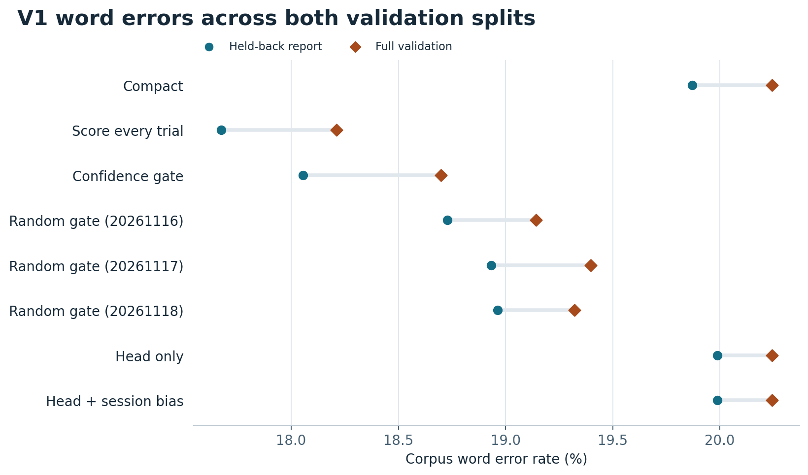
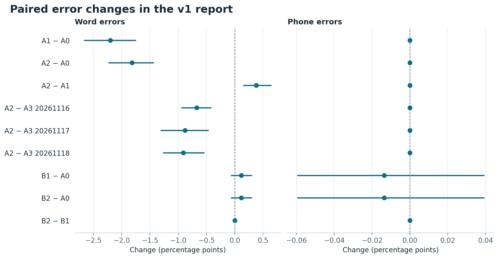
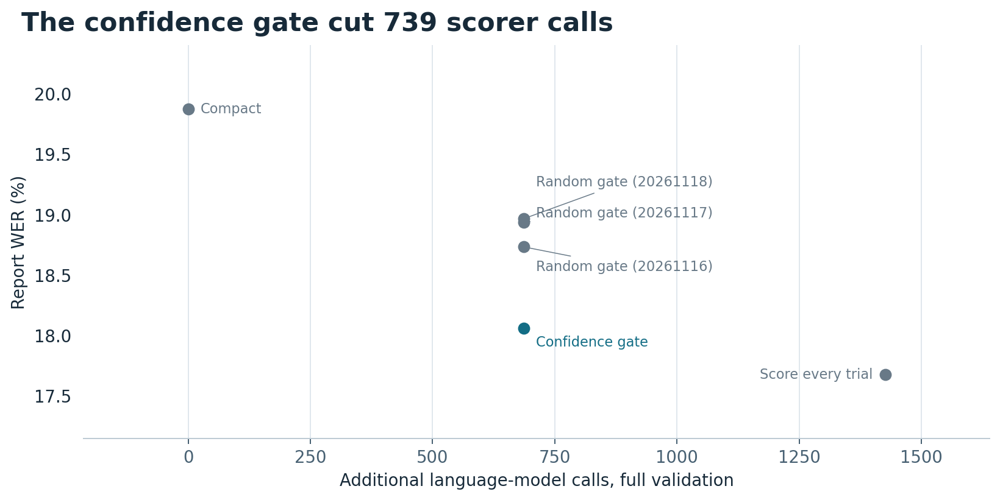
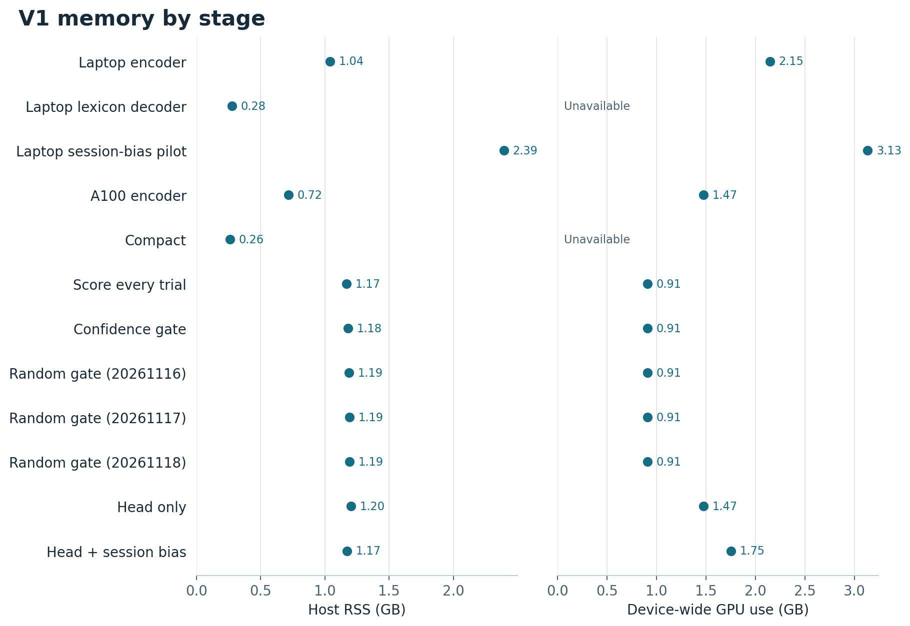

# Measured results

WER on the held-back `dev_report` selection was 19.87% for the compact baseline, 17.67% when rescoring every trial, and 18.05% with the confidence gate. The tables retain every registered condition.

Joint freeze: `c7b12685c9552344144b0f089a0a3c4d7dc6bec88e6df513e52947e926ba7b56`.

Rates divide summed edit counts by summed reference lengths; failed and missing outputs remain in the denominator. The `official_val` aggregate includes tuning trials. The original checkpoint was selected using validation, and these results cover one participant.

Cluster compact decoder: `kenlm_3gram`; natural-log LM weight 2.00.

| Selection | Condition | Trials | Word edits / words | WER | Phone edits / phones | PER | Failed |
|---|---|---:|---:|---:|---:|---:|---:|
| dev_report | A0 · Compact | 500 | 678 / 3412 | 19.87% | 1550 / 14712 | 10.54% | 0 |
| dev_report | A1 · Every trial | 500 | 603 / 3412 | 17.67% | 1550 / 14712 | 10.54% | 0 |
| dev_report | A2 · Confidence gate | 500 | 616 / 3412 | 18.05% | 1550 / 14712 | 10.54% | 0 |
| dev_report | A3 · Random seed 20261116 | 500 | 639 / 3412 | 18.73% | 1550 / 14712 | 10.54% | 0 |
| dev_report | A3 · Random seed 20261117 | 500 | 646 / 3412 | 18.93% | 1550 / 14712 | 10.54% | 0 |
| dev_report | A3 · Random seed 20261118 | 500 | 647 / 3412 | 18.96% | 1550 / 14712 | 10.54% | 0 |
| dev_report | B1 · Head | 500 | 682 / 3412 | 19.99% | 1548 / 14712 | 10.52% | 0 |
| dev_report | B2 · Session + head | 500 | 682 / 3412 | 19.99% | 1548 / 14712 | 10.52% | 0 |
| official_val | A0 · Compact | 1426 | 1912 / 9445 | 20.24% | 4219 / 41392 | 10.19% | 0 |
| official_val | A1 · Every trial | 1426 | 1720 / 9445 | 18.21% | 4219 / 41392 | 10.19% | 0 |
| official_val | A2 · Confidence gate | 1426 | 1766 / 9445 | 18.70% | 4219 / 41392 | 10.19% | 0 |
| official_val | A3 · Random seed 20261116 | 1426 | 1808 / 9445 | 19.14% | 4219 / 41392 | 10.19% | 0 |
| official_val | A3 · Random seed 20261117 | 1426 | 1832 / 9445 | 19.40% | 4219 / 41392 | 10.19% | 0 |
| official_val | A3 · Random seed 20261118 | 1426 | 1825 / 9445 | 19.32% | 4219 / 41392 | 10.19% | 0 |
| official_val | B1 · Head | 1426 | 1912 / 9445 | 20.24% | 4214 / 41392 | 10.18% | 0 |
| official_val | B2 · Session + head | 1426 | 1912 / 9445 | 20.24% | 4214 / 41392 | 10.18% | 0 |

## Laptop lexicon-only fallback

On 926 `dev_tune` trials, the Windows laptop fallback made 4572 / 6033 word edits (75.78% WER) and 2669 / 26680 phone edits (10.00% PER). It used no KenLM. This evaluation uses a different decoder and selection from the cluster study.

Greedy phone sequences agree between the laptop and A100 on 1426 / 1426 validation trials. Trial order and frame lengths match: true. The check uses no references; agreement in decoded phone IDs and lengths does not establish bitwise logit equality.

## Paired changes

On `dev_report`, negative B-minus-A changes mean fewer errors. Changes are in percentage points, with session cluster 95% intervals in the table. The figure shows the same session intervals; JSON also retains paired trial and session/block intervals. These intervals describe resampling within this participant's dataset.

| B minus A | WER change | Session 95% interval | PER change | Fewer / more / unchanged word edits |
|---|---:|---:|---:|---:|
| A1-minus-A0 | -2.20 | [-2.67, -1.75] | +0.00 | 77 / 7 / 416 |
| A2-minus-A0 | -1.82 | [-2.23, -1.43] | +0.00 | 62 / 5 / 433 |
| A2-minus-A1 | +0.38 | [+0.15, +0.65] | +0.00 | 2 / 15 / 483 |
| A2-minus-A3_seed20261116 | -0.67 | [-0.95, -0.41] | +0.00 | 31 / 10 / 459 |
| A2-minus-A3_seed20261117 | -0.88 | [-1.31, -0.46] | +0.00 | 36 / 10 / 454 |
| A2-minus-A3_seed20261118 | -0.91 | [-1.27, -0.54] | +0.00 | 34 / 8 / 458 |
| B1-minus-A0 | +0.12 | [-0.07, +0.30] | -0.01 | 5 / 9 / 486 |
| B2-minus-A0 | +0.12 | [-0.07, +0.30] | -0.01 | 5 / 9 / 486 |
| B2-minus-B1 | +0.00 | [+0.00, +0.00] | +0.00 | 0 / 0 / 500 |

## Additional LM calls

Call and candidate counts cover full validation, including tuning trials. The saved fraction compares each policy with rescoring every trial. Latencies time live additional LM calls; shared compact decoding and scorer setup are measured separately. The figure plots `dev_report` WER against `official_val` LM calls; call latency appears in the table.

| Condition | Calls | Candidates | Failures | Calls saved | Saved fraction | Called p95 seconds |
|---|---:|---:|---:|---:|---:|---:|
| A0 · Compact | 0 | 0 | 0 | 1426 | 100.00% | — |
| A1 · Every trial | 1426 | 12795 | 0 | 0 | 0.00% | 0.07 |
| A2 · Confidence gate | 687 | 6747 | 0 | 739 | 51.82% | 0.07 |
| A3 · Random seed 20261116 | 687 | 6305 | 0 | 739 | 51.82% | 0.07 |
| A3 · Random seed 20261117 | 687 | 6247 | 0 | 739 | 51.82% | 0.07 |
| A3 · Random seed 20261118 | 687 | 6323 | 0 | 739 | 51.82% | 0.07 |

Scorer setup: 41.02 seconds. Sum of cached compact trial decoding times: 32.64 seconds.

## Unusual and random corpora

The public table reports corpus aggregates under group aliases. Source labels, individual OOV words, and examples are excluded.

| Selection | Condition | Group | Trials | Word edits / words | WER |
|---|---|---|---:|---:|---:|
| official_val | A0 | random_1 | 39 | 81 / 200 | 40.50% |
| official_val | A1 | random_1 | 39 | 89 / 200 | 44.50% |
| official_val | A2 | random_1 | 39 | 86 / 200 | 43.00% |
| official_val | A3_seed20261116 | random_1 | 39 | 85 / 200 | 42.50% |
| official_val | A3_seed20261117 | random_1 | 39 | 84 / 200 | 42.00% |
| official_val | A3_seed20261118 | random_1 | 39 | 87 / 200 | 43.50% |
| official_val | B1 | random_1 | 39 | 81 / 200 | 40.50% |
| official_val | B2 | random_1 | 39 | 81 / 200 | 40.50% |

## Reference vocabulary coverage

| Selection | Vocabulary | OOV tokens | OOV types | OOV token rate |
|---|---|---:|---:|---:|
| dev_report | Pronunciation lexicon | 68 | 6 | 1.99% |
| dev_report | Training LM | 193 | 186 | 5.66% |
| official_val | Pronunciation lexicon | 212 | 10 | 2.24% |
| official_val | Training LM | 595 | 554 | 6.30% |

## Measured resources

Calibration rows include sequential training, inference, decoding and evaluation; JSON retains the measurements for each stage. Memory is reported in decimal GB. Process/tree RSS, total device usage, and framework allocations measure different quantities. Failed or budget-stopped outcomes remain in the table when supplied.

| Context | Condition / stage | Seconds | Host RSS GB | Device used GB | CUDA allocated GB | Outcome |
|---|---|---:|---:|---:|---:|---|
| study | A0 · Compact | 39.82 | 0.26 | — | — | complete |
| study | A1 · Every trial | 107.41 | 1.17 | 0.91 | 0.35 | complete |
| study | A2 · Confidence gate | 66.74 | 1.18 | 0.91 | 0.35 | complete |
| study | A3 · Random seed 20261116 | 63.90 | 1.19 | 0.91 | 0.35 | complete |
| study | A3 · Random seed 20261117 | 63.34 | 1.19 | 0.91 | 0.35 | complete |
| study | A3 · Random seed 20261118 | 63.78 | 1.19 | 0.91 | 0.35 | complete |
| study | B1 · Head | 214.81 | 1.20 | 1.47 | — | stage summaries |
| study | B2 · Session + head | 180.24 | 1.17 | 1.75 | — | stage summaries |
| laptop | Laptop inference | 132.49 | 1.04 | 2.15 | 0.37 | complete |
| laptop | Laptop word search | 67.52 | 0.28 | — | — | complete |
| laptop | Laptop session pilot | 905.10 | 2.39 | 3.13 | 0.51 | complete |

## Optional test exports

These export checks verify file coverage and ordering. Test labels are unavailable, so they provide no test accuracy result.

| Condition | Rows | Expected | Empty text | Sequential IDs |
|---|---:|---:|---:|---|
| A0 | 1450 | 1450 | 0 | verified |

[Saved model predictions](model_predictions.json) contain 5 predeclared examples for the five primary conditions, with model text and status. References and phone labels are excluded.

[results.json](results.json) contains the aggregate counts, every interval, resource counters, and input hashes. SVG versions of the charts are in `figures`.
