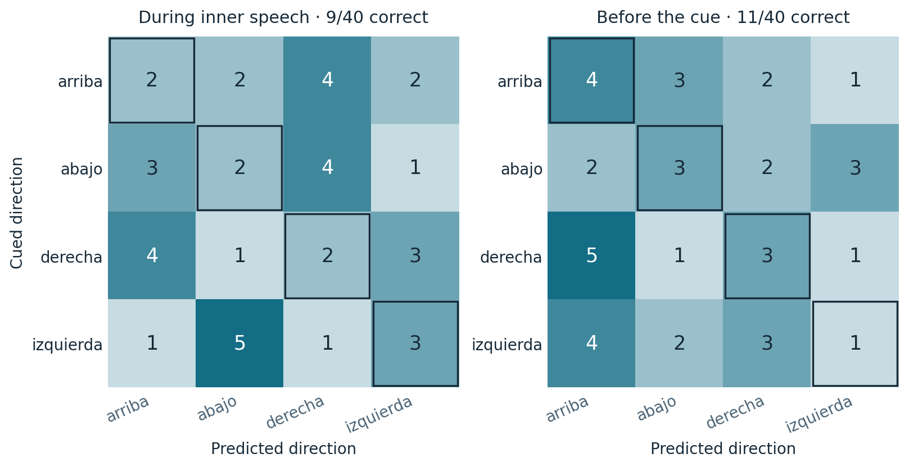

# Scalp EEG, four directions

The classifier identified 9 of 40 imagined commands in a held-out recording session. With ten trials for each Spanish direction, uniform guessing would get ten right on average. A second classifier that saw only activity before the direction cue got 11 right. This experiment found no evidence that the action window helped identify the word. [Aggregate scores, confusion matrices and hashes](scalp_eeg.json)

| Two-second window | Correct | Accuracy | 95% Wilson interval | Warm p50 / p95 |
|---|---:|---:|---:|---:|
| Inner speech, starting 250 ms after the action marker | 9/40 | 22.5% | 12.3–37.5% | 11.3 / 12.9 ms |
| Before the direction appeared | 11/40 | 27.5% | 16.1–42.8% | 11.2 / 13.2 ms |



Rows show the ten trials for each cued direction. Outlined cells are correct predictions. The intervals above use trials as sampling units. There is one held-out session and one participant.

Both classifiers trained on 160 trials from participant 01's first two sessions and predicted the four labels *arriba*, *abajo*, *derecha*, and *izquierda* in session 03. The input was 128-channel scalp EEG at 1,024 Hz. Each model used four frequency bands and a fixed ridge penalty. We extracted trials from the raw BioSemi recordings so that no fitted preprocessing from session 03 entered training. The final file contains an incomplete last record. All 40 eligible windows end in complete records. [Fixed protocol](../docs/SCALP_EEG_CHECK.md) · [Recording and event descriptions](https://pmc.ncbi.nlm.nih.gov/articles/PMC8844234/)

Each timing starts at the read of a two-second epoch from a memory-mapped file and ends when the classifier returns its label. There were three warm passes over the 40 trials per condition. At action onset, collecting this window would take 2.25 seconds before classification could finish. The measured process averaged 1.03 busy CPU cores on Gilbreth. The job cgroup peaked at 0.422 GB and sampled process-tree RSS peaked at 0.651 GB. Those counters use different accounting scopes. Slurm supplied a GPU with the standby allocation. All model fitting and classification used the CPU.

This task gives the decoder each trial boundary and four possible answers. It supplies no evidence about open-vocabulary sentences, new users or consumer headsets. A direction cue can also cause activity that outlasts the visible cue. We retained all eligible trials and did no muscle-artifact rejection. The published T15 WERs elsewhere in this repository come from a different participant, electrode placement and task.

## Reproduce

Use the project Python environment inside a Gilbreth allocation. Run from the checkout with a fresh output directory. The files are from OpenNeuro ds003626 version 2.0.0, licensed CC0. The acquisition script checks each file against the byte count and MD5 in the pinned Git-annex tree, then records SHA-256. Gilbreth job 12625905 acquired and verified 1,882,207,989 bytes in 34.1 seconds. Job 12625913 completed classification. An earlier setup allocation exited before downloading when the non-login environment omitted its scratch variable. [Dataset attribution and license](https://github.com/OpenNeuroDatasets/ds003626/blob/2.0.0/dataset_description.json)

```bash
export PYTHONPATH="$PWD/src"
export OPENBLAS_NUM_THREADS=1 OMP_NUM_THREADS=1 MKL_NUM_THREADS=1
project="${RCAC_SCRATCH:-/scratch/gilbreth/$USER}/btt-25-cw"
data="$project/datasets/ds003626-2.0.0/sub-01"
run="$project/eeg-replay-$SLURM_JOB_ID"
python -m btt25.scalp_eeg_setup --root "$data" --output "$run/setup"
python -m btt25.scalp_eeg --root "$data" --output "$run/study" \
  --registration docs/SCALP_EEG_CHECK.md --acquisition "$run/setup/acquisition.json"
```

The study directory contains the two fitted classifiers, a prediction per trial and window, request timings, confusion matrices and job telemetry.
