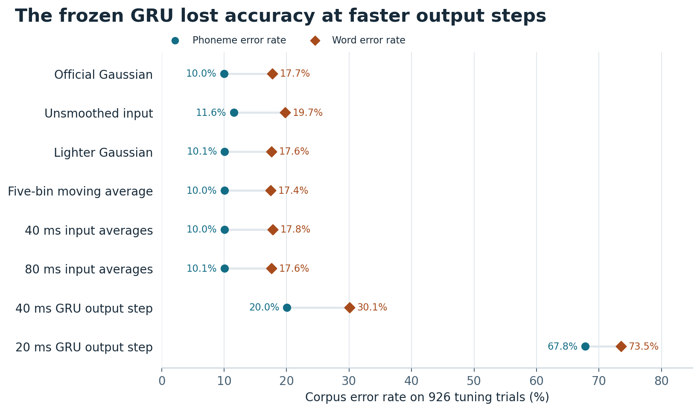
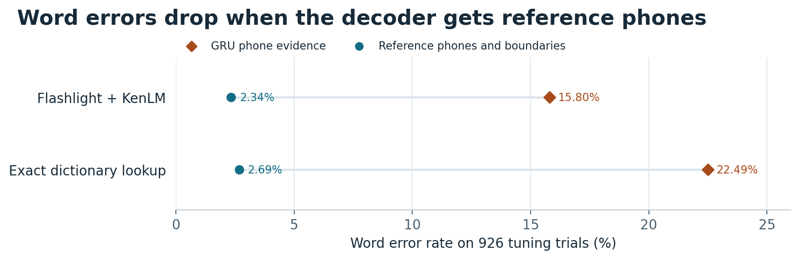

# What the T15 GRU needs from its inputs

The official frozen GRU tolerated several smoothing filters and wider input averages. It lost accuracy when smoothing was removed or when the recurrent model was stepped more often than during training. All eight conditions decoded the same 926 `dev_tune` trials using repaired Flashlight, beam 50, and the training-only KenLM 3-gram.

| Feature representation | GRU output step | Phone edits / 26,680 | PER | Word edits / 6,033 | WER | Paired WER change, 95% interval |
| --- | ---: | ---: | ---: | ---: | ---: | ---: |
| Official Gaussian | 80 ms | 2,669 | 10.00% | 1,069 | 17.72% | Reference |
| Unsmoothed input, aligned crop | 80 ms | 3,090 | 11.58% | 1,191 | 19.74% | +1.31 to +2.82 pp |
| Gaussian σ = 1 bin | 80 ms | 2,691 | 10.09% | 1,061 | 17.59% | −0.53 to +0.27 pp |
| Five-bin moving average | 80 ms | 2,678 | 10.04% | 1,051 | 17.42% | −0.68 to +0.07 pp |
| 40 ms block average, then official smoothing | 80 ms | 2,680 | 10.04% | 1,072 | 17.77% | −0.22 to +0.32 pp |
| 80 ms block average, then official smoothing | 80 ms | 2,684 | 10.06% | 1,062 | 17.60% | −0.52 to +0.29 pp |
| Official Gaussian | 40 ms | 5,349 | 20.05% | 1,815 | 30.08% | +10.64 to +14.16 pp |
| Official Gaussian | 20 ms | 18,085 | 67.78% | 4,436 | 73.53% | +51.73 to +60.32 pp |

The intervals resample 43 session-block groups with matched trial coverage. Five-bin averaging saved 18 word edits and added nine phone edits relative to the official filter. Its interval includes zero. The coarser views average complete blocks of released standardized 20 ms features and hold the mean over the original grid. The stride conditions keep the 14-bin window and change the rate at which the pretrained GRU advances through those windows.



Peak cgroup charge across the eight conditions was 3.07 GB. Peak PyTorch-allocated VRAM was 0.47 GB and the largest device-wide reading was 2.35 GB. Each run included model and decoder startup and scored all 926 predictions in 52 to 155 seconds. These are whole-run timings on one A100 per condition.

## Learned combinations of the three views

The raw and lightly filtered paths entered through a zero-initialized residual around the official Gaussian path. All three training arms used the same training trials, update order, optimizer, and 80 ms output step. The GRU weights were frozen. Gradients for the fusion arms flowed through the GRU to the input adapter. The fixed 256-update comparison separates the representation change from differences in throughput during the 900-second pilots.

| Trainable components | Added input weights | PER at 256 updates | WER at 256 updates | WER after 900 s | Peak host cgroup charge |
| --- | ---: | ---: | ---: | ---: | ---: |
| Phone head | 0 | 10.01% | 17.87% | 18.40% | 11.08 GB |
| Phone head and channel-wise fusion | 1,024 | 10.02% | 17.95% | 18.20% | 11.78 GB |
| Phone head and dense fusion | 524,288 | 9.98% | 17.85% | 18.32% | 11.83 GB |

Dense fusion saved one word edit relative to the matched head-only control. Its paired WER interval was −0.30 to +0.26 percentage points. All three arms made more word errors than the unchanged checkpoint at both endpoints. The sustained endpoints had different update counts. Peak PyTorch-allocated VRAM across the three pilots was 0.52 GB. Checkpoints and predictions for both endpoints are on Gilbreth under jobs `12619117`, `12619118`, and `12619119`.

## Where phone errors enter

The frozen GRU made 2,669 phone edits. The most frequent substitution was `D → T` (60), followed by `T → D` (57). Removing smoothing increased `T` deletions from 49 to 79. At 20 ms output steps, `T` insertions rose from 35 to 996. It recovered 6,002 of 6,033 reference SIL tokens at the official 80 ms step on the selected edit alignment. The released labels provide phone sequences, so they cannot locate those errors against measured phone onsets.

The stop and affricate group from the attachment, `P B T D K G CH JH`, had 605 substitutions or deletions on 4,295 targets with the official filter (14.09%). Removing smoothing raised this to 728 (16.95%). Light Gaussian smoothing gave 607 (14.13%) and five-bin averaging gave 605 (14.09%). The 20 ms output condition added 2,395 insertions of these phones, up from 86 at 80 ms. This pattern is consistent with changing the clock of a model trained at 80 ms per step. The released recordings cannot test changes to acquisition bins below 20 ms.

| Input | Word decoder | Word edits / 6,033 | WER |
| --- | --- | ---: | ---: |
| Saved GRU emissions | Repaired beam-250 Flashlight and KenLM | 953 | 15.80% |
| Reference phones injected into aligned CTC emissions | Repaired beam-250 Flashlight and KenLM | 141 | 2.34% |
| Greedy GRU phones and predicted SIL | Exact CMU pronunciation lookup and training unigram | 1,357 | 22.49% |
| Reference phones and reference SIL | Exact CMU pronunciation lookup and training unigram | 162 | 2.69% |



Job `12619225` emitted each reference phone for one frame and filled the rest of the original 80 ms output grid with blanks. It preserved the exact phone path among the decoder's returned candidates on 922 of 926 trials. Selecting the lowest-error returned candidate on each trial gave 32 / 6,033 word edits (0.53%). The exact lookup had 724 unmatched segments with greedy GRU phones and 14 with reference phones. Of the 6,033 reference segments, 3,161 had multiple pronunciation matches.

On the random-word corpus, replacing the actual GRU emissions with the reference-phone construction reduced edits from 76 to 11 across 200 words. This is a setting where context provides less help than it does on conversational text.

The gap supports improving the neural evidence before expanding the language model. Its size depends on the injected confidence, frame placement, and reference SIL, so it does not isolate a causal fraction of deployable errors. A first construction that held each phone for multiple frames retained zero exact paths. With that construction, sustained word-final phones can conflict with the decoder's transition back to the trie root. The one-frame construction and exact lookup provide complementary checks.

## Other encoder options

A useful next test is a two-rate encoder that keeps the official 80 ms GRU state updates and learns intermediate phone emissions at 40 ms from the intervening feature bins. Initialize each intermediate emission by repeating its preceding 80 ms logit row. This preserves the initial greedy CTC phone sequence while letting the intermediate head learn a correction. Compare it with a matched 80 ms update control and an encoder retrained directly at 40 ms. Report repeated-phone insertions and stop and affricate errors alongside corpus PER and WER. The small scratch-trained Transformer and the diphone adaptation from the previous campaign both lost accuracy under the shared decoder. [Previous encoder results](continuation.md)

MAS-BIT offers a released checkpoint for a different comparison. It lets a shared 1.7B text backbone consume continuous neural features and soft phone probabilities. Its authors report 3.892% private T15 WER with full-utterance attention and 31.1 GiB peak host RSS including loading and audits on an A40. The released loader eagerly materializes the splits. A T15-only adapter using our lazy feature loader could test inference under a smaller host budget. Their checkpoint was selected on both participants' validation sets, which would make a local validation comparison exploratory. [Paper](https://arxiv.org/abs/2611.29457) · [Released code](https://github.com/BaochaiXue/Multi_Agent_System_for_BraIn_to_Text) · [Checkpoint](https://huggingface.co/XinjieZhang/MAS-BIT)

## Larger language models on the same candidates

The two Qwen releases scored up to 25 saved candidates per trial with pinned Q4_K_M weights and llama.cpp. Each condition adds the language model's log-likelihood of the candidate to the same acoustic score. The scorer uses exact candidate tokens, an end-of-text token at both ends, and FP32 accumulation. It never generates replacement text. General-pretraining overlap with T15 transcripts is unknown. [Qwen3.8 27B](https://huggingface.co/Qwen/Qwen3.8-27B) · [Qwen3.6 35B-A3B](https://huggingface.co/Qwen/Qwen3.6-35B-A3B)

| Reranker | Word edits / 6,033 | Tuning WER |
| --- | ---: | ---: |
| Repaired compact, KenLM only | 953 | 15.80% |
| DistilGPT2 | 802 | 13.29% |
| Qwen3-1.7B-Base | 814 | 13.49% |
| Qwen3-4B-Base | 809 | 13.41% |
| Qwen3.6 35B-A3B | 840 | 13.92% |
| Qwen3.8 27B | 846 | 14.02% |

Both new rerankers returned text for all 926 tuning trials. Each chose weight 1.25, the highest value in the registered grid. Relative to DistilGPT2, Qwen3.6 made 38 more edits (+0.63 percentage points, paired 95% interval +0.17 to +1.06) and Qwen3.8 made 44 more (+0.73 points, +0.22 to +1.20). On the 200 random words, compact made 76 errors, DistilGPT2 made 82, Qwen3.6 made 80, and Qwen3.8 made 76. The shared top-25 oracle has 603 edits (9.995%). One additional edit puts WER above 10%. A practical route below that level needs better candidate coverage.

On the 24-trial throughput pilot at weight 1.25, Qwen3.8 made 18 word edits, Qwen3.6 and DistilGPT2 each made 20, Qwen3-4B made 19, and compact decoding made 23. That subset contained 156 reference words. The ordering changed on the full tuning split.

Serial and whole-sequence scoring disagreed on the startup fixture by 0.062 nats for Qwen3.8 and 0.692 nats for Qwen3.6. Both trials used serial teacher forcing and repeated the same fixture after scoring an unrelated candidate. The scorer reproduced the serial fixture in each case. Both models loaded all weights onto their allocated A100s. The two initial pilots ran on different A100 variants, so their latency measurements describe those allocations.

Setup job `12619071` built the pinned CUDA backend, downloaded the two weight files, and verified their SHA-256 hashes in 18 minutes 37 seconds. Qwen3.8's pilot forecast 7,792 seconds for full coverage with a margin, exceeding its original allocation. The continuation uses the completed pilot and the same GPU class. It compares the scorer binary, candidate, and model hashes, then scores one pilot trial again before using the cached results.

On the 902 requests after its pilot, Qwen3.6 rescoring took 1.86 s at p50 and 2.93 s at p95. The PCIe A100 run used 1.69 GB peak cgroup memory and 21.84 GB peak device-wide GPU memory. The job took 42 minutes 40 seconds including the pilot. Qwen3.8 rescoring took 4.57 s at p50 and 7.55 s at p95 across the 902 requests after its pilot. Its SXM4 A100 run used 1.62 GB peak cgroup memory and 20.80 GB peak device-wide GPU memory. The continuation took 1 hour 6 minutes 45 seconds after a separate 16-minute 41-second pilot.

Job `12621644` timed the two scorers on the same A100-SXM4 with four allocated CPU cores. Each model handled 72 cached-candidate requests across three alternating passes, with zero failures. Model loading is separate from request timing.

| Scorer | p50 | p90 | p95 | p99 | Max | Real-time factor |
| --- | ---: | ---: | ---: | ---: | ---: | ---: |
| Qwen3.6 35B-A3B, Q4_K_M | 1.76 s | 2.58 s | 2.66 s | 2.98 s | 2.99 s | 0.092 |
| Qwen3.8 27B, Q4_K_M | 4.48 s | 6.77 s | 6.98 s | 7.83 s | 8.03 s | 0.235 |

The matched job peaked at 1.88 GB of host cgroup charge and 21.84 GB of device-wide GPU memory. First loads took about 40 seconds per model. Reloads took 9 to 11 seconds. The real-time factor divides total scorer time by original neural input duration. This benchmark starts from saved word candidates and omits feature reads, encoder inference, and search.

## Reproducing the screen

The screen ran as jobs `12618760` and `12618761`. Each condition writes tuning predictions, edit counts, its resolved configuration, input hashes, and process telemetry in private scratch. The `btt25.temporal_analysis` command checks trial coverage and counts against the tuning allowlist before computing paired intervals. The reference-phone runs use `btt25.reference_phone_diagnostic` with the same allowlist.

Before running the diagnostic on a fresh copy, build its homophone tie-break counts from the normalized training text saved by the earlier KenLM build. The verified original counts cover 50,645 tokens and 3,744 word types.

```bash
project="$RCAC_SCRATCH/btt-25-cw"
p="$project/v3-smoothing-20261127"
python3 - "$project/workspace/runs/compact-a100/lm/train-normalized.txt" \
  "$p/assets/train_unigrams.json" <<'PY'
from collections import Counter
import json
from pathlib import Path
import sys

source, output = map(Path, sys.argv[1:])
counts = Counter(source.read_text(encoding="utf-8").split())
with output.open("x", encoding="utf-8") as file:
    json.dump({"source_split": "train", "counts": counts}, file)
PY
```

```bash
p="$RCAC_SCRATCH/btt-25-cw/v3-smoothing-20261127"
for group in smoothing sampling reference-spike pilot-control pilot-fusion pilot-dense; do
  sbatch -A ieee-smcs -p a100-40gb --qos=normal --gres=gpu:1 \
    --cpus-per-task=4 --mem=15000M --time=00:32:00 --signal=B:USR1@90 \
    -J "btt-$group" -o "$p/logs/btt-$group-%j.log" \
    "$p/hpc/gilbreth_v3_temporal.sh" "$p" "$group"
done
```

To resume Qwen3.8 from the saved throughput pilot on Gilbreth, use the verified acquisition job and prior scorer IDs. This resumes scoring the original candidate list.

```bash
model=Qwen3.8-27B
sbatch -A ieee-smcs -p a100-40gb --qos=normal -C nvlink --gres=gpu:1 \
  --cpus-per-task=4 --mem=15000M --time=02:35:00 --signal=B:USR1@90 \
  -J "btt-$model-resume" -o "$p/logs/btt-$model-resume-%j.log" \
  "$p/hpc/gilbreth_v3_frontier_score.sh" "$p" "$model" 12619071 9000 12620737
```
