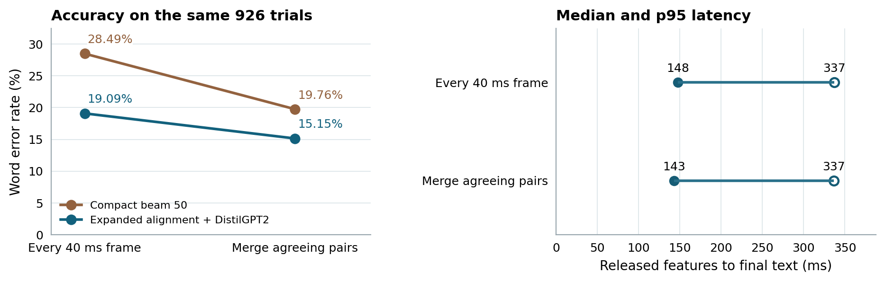

# Word decoding from the trained 40 ms phone model

Merging adjacent 40 ms frames when they agreed on the most likely phone reduced word errors from **1,152 to 914** on the same 6,033 words. Both versions produced exactly the same greedy phone string on every trial. With the merged frames, the stronger word decoder reached **15.15% WER**. The official 80 ms GRU with the same word rule still has the lowest measured WER on this tuning split, **12.66%**. [Official 80 ms results](phone_robustness.md)



| Trained 40 ms output | Compact beam 50 WER | Expanded decoder WER | Best available candidate WER | Greedy PER |
|---|---:|---:|---:|---:|
| Every frame | 1,719 / 6,033 · 28.49% | 1,152 / 6,033 · 19.09% | 937 / 6,033 · 15.53% | 3,175 / 26,680 · 11.90% |
| Merge agreeing pairs | 1,192 / 6,033 · 19.76% | 914 / 6,033 · **15.15%** | 697 / 6,033 · 11.55% | 3,175 / 26,680 · 11.90% |

The trained model updates its recurrent state every 80 ms and learns an intermediate phone distribution every 40 ms. We paired successive outputs from the start of each trial. When their argmax matched, the word decoder received their mean posterior. Different winners and unpaired final frames were kept. This reduced the input to word search from 413,353 to 215,795 frames, a 47.8% reduction. The encoder still computed every 40 ms output.

The expanded decoder started with up to 25 distinct sentences from beam-250 lexical search and added up to 25 proposals derived from single-phone edits within predicted word boundaries. Each sentence received the summed CTC alignment score of its retained pronunciation plus 1.25 times its teacher-forced DistilGPT2 log likelihood. The word rules and model weights were fixed before this comparison. We scored all 926 development trials, with zero empty predictions in either row. This split had already informed the project. [Compact decoder controls](rate_decode_v4.md) · [Candidate rules and word-scoring experiments](phone_robustness.md)

Merging lowered WER by 3.94 percentage points. It helped 211 trials, hurt 57 and left 658 tied by word-error count. A 2,000-draw paired bootstrap over 43 session blocks gave a 95% interval of 2.72–5.16 points lower WER. Substitutions fell from 1,019 to 813 and insertions from 119 to 78, while deletions rose from 14 to 23. On the 200 random-corpus words, errors fell from 102 to 92. Errors on the 201 Harvard words rose from 81 to 85.

The improved lists contained better sentences. An oracle choosing the closest *available* candidate on each trial saved 240 edits after merging. The actual selector saved 238. Even perfect ranking of the merged lists would still leave 697 edits, or 11.55% WER. Reaching 10% on these trials requires better candidates or more informative phone probabilities. [Aggregate counts, corpus breakdown and uncertainty](two_rate_expanded.json)

## Features to final text

| Trained 40 ms output | p50 | p90 | p95 | p99 | Max | Pooled real-time factor |
|---|---:|---:|---:|---:|---:|---:|
| Every frame | 148 ms | 303 ms | 337 ms | 392 ms | 437 ms | 0.00930 |
| Merge agreeing pairs | 143 ms | 306 ms | 337 ms | 388 ms | 391 ms | 0.00929 |

Each batch-one request read the released HDF5 features, ran the trained encoder, searched and expanded its candidates, scored them on the GPU and returned one final text. We used 24 length-stratified trials and three interleaved passes per route after warmup. All 144 measured requests reproduced their saved predictions. Pooled RTF divides total warm compute time by the original feature duration at 20 ms per bin. The merged route delivered 5.79 complete utterances per compute second. This offline benchmark does not measure live word commitment. [Trained phone-output cadence and laptop replay](consumer_v4.md)

Gilbreth job `12627738` used one NVIDIA A100-SXM4-40GB and four allocated CPU cores. Shared cold setup took 89.9 s. The entire job finished in 5 min 55 s against a 32.0-minute forecast and a 42.5-minute application budget. Peak memory across both conditions was 4.15 GB for the job cgroup including file cache, 2.03 GB process-tree RSS, 0.54 GB PyTorch GPU allocation, 1.05 GB PyTorch GPU reservation and 1.60 GB device-wide GPU memory. All GB values are decimal. The job requested 13,000 MiB of host memory. [Timing distributions by recording length and resource counters](two_rate_expanded.json)

## Reproduce

On the established Gilbreth workspace, submit this comparison from the checkout containing `src/`, `configs/` and `scripts/`.

```bash
BTT_TWO_RATE_SOURCE="$PWD" sbatch hpc/gilbreth_v4_two_rate_expanded.sh
```

The launcher names the verified 2,048-update checkpoint and prior search, pilot and timing artifacts. Its output includes all tuning predictions, candidate scores, transformed logits, hashes and timing traces. To run the merged model from features without a candidate archive, add the following flags to the documented reference-free inference command. Omit `--merge-agree` for every 40 ms frame. [Full feature-to-text inference command](phone_robustness.md#reproduce-on-the-established-gilbreth-workspace) · [Training and checkpoint instructions](../docs/REPRODUCE_RATE_STUDY.md)

```bash
--trained-two-rate "$RCAC_SCRATCH/btt-25-cw/v4-rate-20261127/runs/two_rate-12625370/study/two_rate" --merge-agree
```

The default digest identifies the measured research checkpoint. For your own completed 2,048-update two-rate training run, pass its study directory with `--trained-two-rate` and its expected lowercase checkpoint digest with `--trained-two-rate-sha256`. The loader checks that digest against both the file and the completed training record, then checks the official parent, model contract, condition and update count. A separately trained checkpoint requires its own accuracy measurement.
